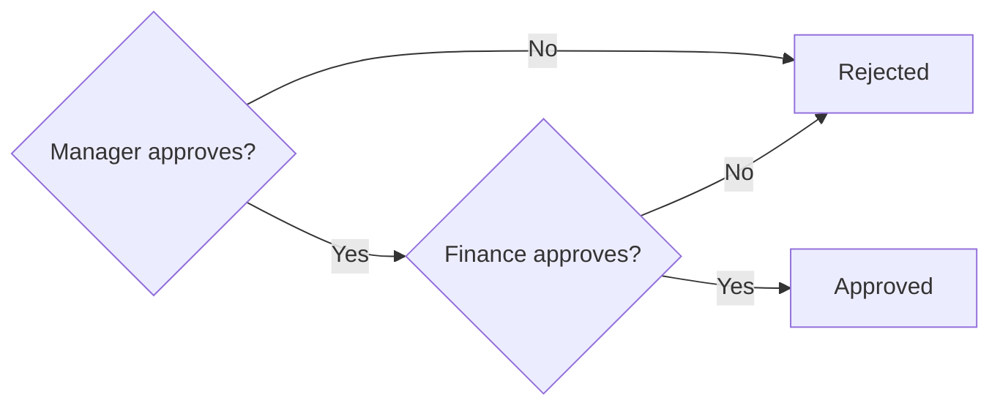

# Rescue R4: Decision gate simulation

A manager rejection should stop a request before finance. The prepared Flow follows the wrong branch. Correct one Condition value and check the two decision paths.

> **Draft rehearsal:** The **B2D2-v2-R04-ApprovalGate-START** baseline is available for the current instructor-account rehearsal. Use only the baseline assigned to you. A complete learner-account copy and runtime check is still required; this availability does not establish classroom readiness.

> **Access:** This simulation uses Power Automate's built-in actions. It sends no approval request or email and needs no workbook. It practices a supplied rule; it does not decide workplace approval authority.

## Your test card

| Test | ManagerDecision | FinanceDecision | Required result after repair |
|---|---|---|---|
| A | Reject | Approve | Rejected; Finance gate is Skipped |
| B | Approve | Approve | Approved; Finance gate runs |



## Setup

<StarterFlowSetup exercise="R4" />

### Check your settings

This flow has no connector actions, workbook or other external file. No connection-account or file-selection check is needed.

### Save and turn on your flow

<FlowReadyCheck />

**Ready checkpoint:** Your assigned personal flow is On. No service connection or file is needed.

## Practice 1: Verify a decision gate {#practice-1-verify-a-decision-gate}

<PracticeIllustration src="/day-2/images/r04-p01.webp" :width="1536" :height="768" alt="A gate checks a decision before allowing a request to proceed to a second stage." />

Correct the manager comparison so a rejection stops the finance branch.

1. On your copy's details page, select **Edit** to open the designer. Then select **Test → Manually → Test** and enter test A:

   - **ManagerDecision**

     ```text
     Reject
     ```

   - **FinanceDecision**

     ```text
     Approve
     ```

2. Select **Run flow**. When the confirmation says the run has started, select **Done**.
3. Wait for the run-result view showing the action statuses. If it does not appear, follow [Open your test result](../preparation.md#open-your-test-result). Select **Manager gate** and inspect the comparison result.
4. Expand **Manager gate** using the arrow beside it. In its **True** branch, notice that **Finance gate** ran even though the manager rejected the request. Expand **Finance gate** using its arrow. In the finance **True** branch, select **Approved result → Outputs** to see the incorrect Approved result.

Use the test card to diagnose the fault, make one repair and run tests A and B. Try the hints below, or open the full solution whenever you need help.

### Progressive hints

<details><summary>Hint 1: Follow the first wrong branch</summary>

The manager's decision controls whether finance can start. Check that Condition before changing any final result text.

</details>

<details><summary>Hint 2: Read the three comparison parts</summary>

Read the input, operator and comparison value in Manager gate. The supplied rule allows finance after manager approval.

</details>

<details><summary>Hint 3: Check Skipped as well as Rejected</summary>

For test A, finance must not run. A final Rejected label is not enough if Finance gate still executed.

</details>

### Solution available {#solution}

Includes the exact repair and both verification tests. Open whenever you need help.

<details class="rescue-solution">
<summary>View step-by-step solution</summary>
<div class="rescue-solution-content">

1. Return to **Edit → Manager gate → Parameters**. Leave the **ManagerDecision** value and **is equal to** operator unchanged. Replace the right-hand comparison value with:

   ```text
   Approve
   ```

2. Save your changes. Select **Test → Manually → Test** and run test A again with the same two inputs. Select **Done** when the confirmation says the run has started, then wait for the run-result view.
3. Expand **Manager gate** if needed. Select the **arrow beside its outer False branch**, to the right of Manager gate and opposite the True branch containing Finance gate. Open **Manager rejected result → Outputs** and check for **Rejected**. In the manager's **True** branch, check that **Finance gate** shows **Skipped**.

   The manager's False branch and the False branch inside Finance gate are separate. If Copilot covers the right side of the Flow, close its panel. Use **Zoom view to fit** if needed to see the outer branch arrow.
4. Select **Edit → Test → Manually → Test**. Enter test B:

   - **ManagerDecision**

     ```text
     Approve
     ```

   - **FinanceDecision**

     ```text
     Approve
     ```

5. Select **Run flow**, then **Done** when the started confirmation appears. Wait for the run-result view. Expand **Manager gate**, then expand **Finance gate** in its **True** branch if needed. Confirm Finance gate ran. In the finance **True** branch, select **Approved result → Outputs** and check for **Approved**.

</div>
</details>

### Checkpoint

Test A returns Rejected and skips Finance gate. Test B runs Finance gate and returns Approved. Record the one setting you changed.

## Reset

Start a new manual run with the original test inputs. This simulation does not change a workbook or issue approvals. Turn off the training Flow during announced cleanup.

Reference: [Add a Condition](https://learn.microsoft.com/power-automate/add-condition).
