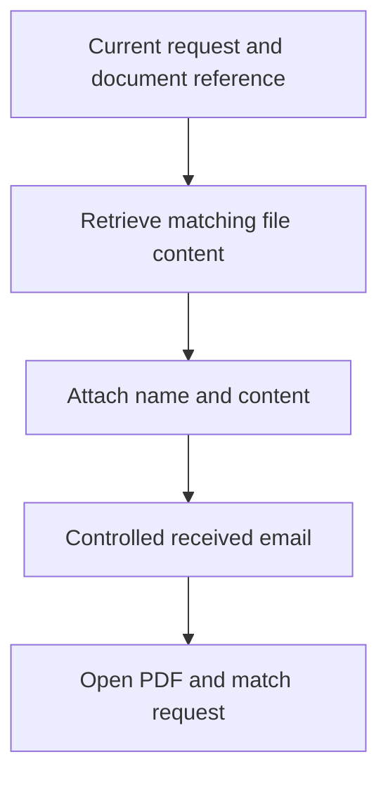

# Exercise 2: Reliable Document Handoff

Two requests need different supporting PDFs. A filename tells the Flow which parcel to collect; file content is what must go inside the envelope. Complete the handoff so each controlled recipient can open the document belonging to that request.

> **Access:** Confirm Power Automate, OneDrive for Business, Excel Online (Business), Office 365 Outlook and the controlled recipients. The supplied PDFs already exist. This exercise retrieves and sends them; it does not generate PDFs. See [Preparation](../preparation.md) and check [starter availability](../downloads.md#starter-flow-status) before live practice.

## Starting resources

- Starter Flow: **B2D2-Core02-DocumentHandoff-START**.
- Independent workbook: **core02-document-handoff.xlsx**, Table `Documents`.
- **DOC-A.pdf** and **DOC-B.pdf**, uploaded to your pair’s `Documents` folder.
- The reset copy and expected results are on [Downloads](../downloads.md).



## Practice 1: Retrieve the correct document

<PracticeIllustration src="/day-2/images/core02-p01.webp" :width="1536" :height="864" alt="A request reference is matched with the correct document on a shelf." />

Use the current document reference to retrieve that document’s actual file content.

1. Import the Core 02 starter and rebind its connections and workbook. This exercise does not depend on your Core 01 workbook.
2. Open `Documents` and verify the supplied mapping, then close the workbook.

   | RequestID | DocumentCode | FileName | RecipientSlot |
   |---|---|---|---|
   | R-101 | DOC-A | DOC-A.pdf | SLOT-A |
   | R-102 | DOC-B | DOC-B.pdf | SLOT-B |

3. Open each PDF in OneDrive once. Confirm its internal document code and request reference, then return to the Flow.
4. Locate the OneDrive retrieval action in the prepared Flow. Check that its selected file or path comes from the **current** row’s file reference. A sharing URL, filename token and file content are different values.
5. Select **Publish** and confirm **Published**, then select **Test → Manually**. Enter the first **RequestID** below, run the test and wait for completion. Repeat with the second value. In Run history inspect `Selected_document`, `Document_path` and `Get_document_content`. The first case must identify DOC-A.pdf; the second must identify DOC-B.pdf.

   **First RequestID**

   ```text
   R-101
   ```

   **Second RequestID**

   ```text
   R-102
   ```

   On **Run flow**, also type the approved SLOT-A mailbox into **RecipientA** and SLOT-B mailbox into **RecipientB**. Both are required on every run. Keep the same addresses for both requests.
6. If the wrong file is selected or retrieval fails, trace the document reference back to the current row. Repair the reference using the correct file picker/path, select **Publish**, confirm **Published** and recheck both cases.

### Checkpoint

Both current request rows retrieve their own PDF content. The retrieval evidence identifies the matching file; it does not contain a guessed sharing link or the previous row’s reference.

## Practice 2: Attach and verify readable content

<PracticeIllustration src="/day-2/images/core02-p02.webp" :width="1536" :height="786" alt="A supporting document is enclosed in the correct email and opened by its recipient." />

Pass the retrieved content into the attachment and verify the PDF in each received email.

1. Open the prepared **Send an email (V2)** action. Confirm its **To** uses the approved recipient slot for the current row.
2. Expand **Attachments**. Check that **Name - 1** retains the selected filename expression below. This correct starter field needs no change; the copyable expression is provided as a reference to its intended source.

   ```text
   outputs('Selected_document')?['FileName']
   ```

   In **Content - 1**, select the entire existing field value and delete it. Type `/`, choose **Insert dynamic content**, then select **Get document content → File content**. Keep it as an inserted token; do not type its label as ordinary text.

   <div class="day2-field-stack" role="figure" aria-label="Email attachment fields in order">
     <div><span class="subject-reference-label">To</span><div class="subject-reference-field"><span class="subject-reference-token">Outputs · Mapped_recipient</span></div></div>
     <div><span class="subject-reference-label">Subject</span><div class="subject-reference-field">[D2 Document] <span class="subject-reference-token">Expression: outputs('Selected_document')?['RequestID']</span> - <span class="subject-reference-token">Expression: outputs('Selected_document')?['DocumentCode']</span></div></div>
     <div><span class="subject-reference-label">Name - 1</span><div class="subject-reference-field"><span class="subject-reference-token">Expression: outputs('Selected_document')?['FileName']</span></div></div>
     <div><span class="subject-reference-label">Content - 1</span><div class="subject-reference-field"><span class="subject-reference-token">File content · Get document content</span></div></div>
   </div>

3. Select **Publish** and confirm **Published**. Run the two supplied cases one at a time. Check the email action’s inputs and the actual messages in the controlled receiving mailbox.
4. Open each **received attachment**. Do not count opening the original OneDrive file as a successful email handoff.

   | Received request | Attachment | Acceptance |
   |---|---|---|
   | R-101 / DOC-A / SLOT-A | DOC-A.pdf | Opens and contains the matching document code and request reference |
   | R-102 / DOC-B / SLOT-B | DOC-B.pdf | Opens and contains the matching document code and request reference |

5. Ask the other pair to compare the two received messages and readable PDFs with the mapping table. Record the first divergence, repair and result.

### Checkpoint

Two correctly matched PDFs open from two received emails. Their request references, codes and filenames agree with the input rows. Passing recipient routing also requires two distinct approved receiving mailboxes; a single-mailbox test verifies content only.

## Reset and troubleshooting

Wait for active runs to finish. Use the Core 02 reset workbook as a new file, reselect every File/Table dependency and restore only your pair’s PDF copies if necessary. Select **Publish** and confirm **Published** before retesting. Keep earlier emails separate by run time.

| Symptom | First checkpoint |
|---|---|
| PDF is unreadable | Check the attachment content token. A filename, path or ID is not file content. |
| Correct filename, wrong document | Inspect the retrieval input for the current row and open the received PDF. |
| File not found | Inspect the selected file/path, folder and connection account before adding a delay. |
| Correct action inputs, no received email | Check the controlled mailbox and connector result; record the exact error if delivery failed. |

References: [OneDrive for Business](https://learn.microsoft.com/connectors/onedriveforbusiness/), [Office 365 Outlook](https://learn.microsoft.com/connectors/office365/).
