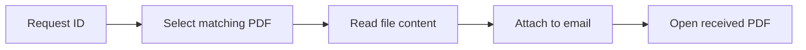

# Exercise 2: Reliable Document Handoff

<PracticeIllustration src="/day-2/images/core02-overview.webp" :width="1536" :height="864" alt="A colleague hands over an envelope containing a document while its recipient checks the document." loading="eager" />

Your team keeps request documents in OneDrive. The prepared flow should find the PDF for a selected request and email it to the matching test recipient: **R-101 → DOC-A.pdf** and **R-102 → DOC-B.pdf**.

The email arrives with an attachment, but the PDF cannot be opened. Think of an envelope with the right label: the label alone does not guarantee that the correct document is inside.

Check which PDF the flow selects and retrieves, then repair how it attaches the document. Test both requests and open each received PDF to confirm it is readable and belongs to the right request.

> **Access:** This exercise uses Power Automate, OneDrive for Business and Outlook. Use your agreed training account and test recipients. The organiser confirms the required service access. **No Excel workbook is needed for this exercise.**

## Starting resources

- Starter: **B2D2-v2-Core02-DocumentHandoff-START**, supplied after the starting-route check.
- Files: **DOC-A.pdf** and **DOC-B.pdf** from the extracted practice files.
- Your agreed **RecipientA** and **RecipientB** addresses.

The starter contains this prepared document list. You do not need to create or edit the list.

| RequestID | Document | Recipient |
|---|---|---|
| R-101 | DOC-A.pdf | RecipientA / SLOT-A |
| R-102 | DOC-B.pdf | RecipientB / SLOT-B |



## Practice 1: Prepare your documents

<PracticeIllustration src="/day-2/images/core02-setup-v2.webp" :width="1536" :height="864" alt="A colleague organises two distinct documents in a training folder." />

Prepare the two PDFs and your personal flow so it can retrieve files from your OneDrive.


### Prepare your OneDrive files

Open [Day 2 downloads](../downloads.md) and select **Download complete Day 2 workshop (ZIP)** if needed. Extract the ZIP: right-click → **Extract All** on Windows, or double-click on Mac. Open **files/** for the practice resources.

1. In OneDrive, open your training folder from Exercise 1. If it is missing, select **Create or upload → Folder** (or **Add new → Folder**) and name it:

   ```text
   B2D2-Operations-Request-Desk
   ```

   Open this folder before the next step.
2. Inside it, open the subfolder below if it already exists. Otherwise, select **Create or upload → Folder** (or **Add new → Folder**) and name it:

   ```text
   Documents
   ```

   <LearnScreenshot image="folder-name" />

3. Open **Documents**. If **DOC-A.pdf** and **DOC-B.pdf** already exist there, continue to the next step to check them. Otherwise, use **Create or upload → Files upload** to upload the supplied PDFs. Keep their filenames unchanged.
4. Open each uploaded PDF once. Confirm that DOC-A contains **R-101** and DOC-B contains **R-102**. Return to the Documents folder.
### Open your personal flow

<StarterFlowSetup exercise="Core02" />

### Check connections and settings

| Action in your own copy | Service |
|---|---|
| Get document content, inside One document → True | OneDrive for Business |
| Send document, inside One document → True | Office 365 Outlook |

<PersonalConnectionCheck />

1. Leave **Document map** and **Document path** unchanged. They already select the correct PDF name under **/B2D2-Operations-Request-Desk/Documents/**; you only need to upload the two files to that folder.

### Save and turn on your flow

<FlowReadyCheck />

### Checkpoint {#setup-checkpoint}

Your Documents folder contains two readable PDFs with their original names. Your personal starter Flow uses your account and is On. You have not changed the attachment content yet.

## Practice 2: Retrieve the correct document {#practice-1-retrieve-the-correct-document}

<PracticeIllustration src="/day-2/images/core02-p01.webp" :width="1536" :height="864" alt="A request reference is matched with the correct document on a shelf." />

Check that the Flow retrieves the right PDF before diagnosing its email attachment.

1. On your copy's details page, select **Edit** to open the designer. Then select **Test → Manually → Test**. If **Sign in** appears, complete the [first-test connection check](../preparation.md#first-test-connection-check). Enter:

   - **RequestID**

     ```text
     R-101
     ```

   - **RecipientA:** your agreed first test address.
   - **RecipientB:** your agreed second test address.

2. Select **Run flow**. When the confirmation says the run has started, select **Done**.
3. Wait for the run-result view showing the action statuses. If it does not appear, follow [Open your test result](../preparation.md#open-your-test-result).
4. Expand **One document**. In its **True** branch, select **Selected document → Outputs**. Confirm **RequestID** is R-101 and **FileName** is DOC-A.pdf.
5. Select **Document path → Outputs**. Confirm that the path ends with **/Documents/DOC-A.pdf**.
6. Select **Get document content**. Confirm that the action succeeded. This action retrieves the PDF's contents, rather than just its filename.
7. In Outlook, open the new email whose subject begins **[D2 Document] R-101 - DOC-A**. Try to open its attachment. Record whether it opens.

### Checkpoint {#checkpoint}

The Flow selected DOC-A.pdf and retrieved its content, but the received attachment is unreadable. You have narrowed the problem to the handoff from retrieved content to the email.

## Practice 3: Attach and verify readable content {#practice-2-attach-and-verify-readable-content}

<PracticeIllustration src="/day-2/images/core02-p02.webp" :width="1536" :height="786" alt="A supporting document is enclosed in the correct email and opened by its recipient." />

Replace the attachment's content value and check the two received PDFs.

1. Return to the Flow and select **Edit**. Expand **One document**, then select **Send document → Parameters**.
2. Find **Attachments**. If its fields are already visible, continue; otherwise expand that section. Leave **Name - 1** unchanged; it already supplies the selected filename.
3. In **Content - 1**, select the entire existing value and delete it.
4. Type `/` in that field and select **Insert dynamic content**.
5. Under **Get document content**, select **File content**. Confirm that it appears as an inserted token.

   <div class="day2-field-stack" role="figure" aria-label="Attachment fields">
     <div><span class="subject-reference-label">Name - 1 — leave unchanged</span><div class="subject-reference-field"><span class="subject-reference-token">Expression: outputs('Selected_document')?['FileName']</span></div></div>
     <div><span class="subject-reference-label">Content - 1 — replace this value</span><div class="subject-reference-field"><span class="subject-reference-token">File content · Get document content</span></div></div>
   </div>

   A filename is like the address on a parcel. **File content** is what goes inside it.
6. [Save your changes](../preparation.md#save-your-changes).
7. Select **Test → Manually → Test**. Enter R-101 and the same recipient addresses. Select **Run flow**, then **Done** at the started confirmation. Wait for the run-result view. Open **DOC-A.pdf from the new received email** and check its internal request reference.
8. Return to the Power Automate tab. Select **Edit → Test → Manually → Test**. Enter the same recipient addresses and **RequestID**:

   ```text
   R-102
   ```

9. Select **Run flow**, then **Done** at the started confirmation. Wait for the run-result view. Open **DOC-B.pdf from the new received email**. Check both results with your partner:

   | Request | Recipient | Received attachment must open and contain |
   |---|---|---|
   | R-101 | RecipientA / SLOT-A | DOC-A and R-101 |
   | R-102 | RecipientB / SLOT-B | DOC-B and R-102 |

### Checkpoint {#checkpoint-1}

Both PDFs open from their received emails and contain the right request references. Opening the original OneDrive PDF is not the email handoff check. Two different approved mailboxes are needed to prove distinct recipient routing.

## Reset and troubleshooting

The Flow only reads the PDFs. Keep the original two files in your Documents folder and start a new manual run. Use each email's received time to distinguish a retest from an old message.

| What you see | Check first |
|---|---|
| Get document content fails | Confirm the exact folder and filename in Document path, and that the PDF exists in your own OneDrive |
| Received attachment still will not open | Check that Content - 1 contains File content from Get document content |
| Correct filename but wrong PDF | Open Selected document in the new run and compare RequestID and FileName |
| No received message | Check the addresses entered in Run flow and the result of Send document |

References: [OneDrive for Business](https://learn.microsoft.com/connectors/onedriveforbusiness/), [Office 365 Outlook](https://learn.microsoft.com/connectors/office365/).
