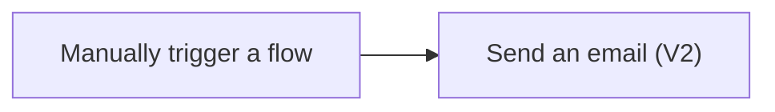

# Exercise 1: Send an email using your input


When a new task arrives, we often type the same notification again. Let a flow prepare that message from the input you enter, like ringing a doorbell and handing over a task slip.

> **License:** This exercise uses the Office 365 Outlook Standard connector. You need cloud-flow access and an authorised Microsoft 365 mailbox. It does not use Premium connectors; the organiser must confirm your service entitlements.

## Before you start

- Open [Power Automate](https://make.powerautomate.com) with your training account and select the environment specified by the instructor.
- Open Outlook for the same account and identify your own email address.
- Use an authorised Office 365 Outlook connection. Ask the instructor for help if the connection fails.



## Practice 1: Create a trigger with a task input

<PracticeIllustration src="/images/practices/ex01-p01.webp" alt="A learner presses a start button beside a task input card." />

Create a manual trigger with one Text input that receives a value when you run the flow.

1. Select **Create → Instant cloud flow** in Power Automate.
2. Enter this flow name:

   ```text
   B2-MyFirstEmail
   ```

3. Select **Manually trigger a flow**, then **Create**.
4. Open the trigger. Select **Add an input → Text** and name the input:

   ```text
   TaskTitle
   ```

5. Check that the input is named **TaskTitle**.
6. Select **Save draft** in the top toolbar and wait for the save confirmation. Then continue to Practice 2 to add the email action.

   > If **Save draft** is not shown, keep this tab open and continue to Practice 2. This button is available for solution-aware flows; other flows use **Save** after the action is configured.

### Quick check

You can see the manual trigger and one `TaskTitle` input, and explain that its value will be supplied when you run the flow.

## Practice 2: Pass the input into an email

<PracticeIllustration src="/images/practices/ex01-p02.webp" alt="A task card becomes part of an outgoing email." />

Use Dynamic content so the email changes with the task input.

1. Select **+ → Add an action** below the trigger. Search for:

   ```text
   Send an email (V2)
   ```

2. Select the action from **Office 365 Outlook**. Check the connector name: Outlook.com is a different service. If prompted, sign in with your training account.
3. In **To**, enter your own authorised training email. Leave **CC** and **BCC** empty.
4. In **Subject**, type this prefix and add **one space** after the colon:

   ```text
   Training task:
   ```

5. Keep the cursor after that space. Select the **Dynamic content** button, which looks like **⚡** on the **right of the Subject input**. Under **Manually trigger a flow**, select **TaskTitle**. It appears as a token beside your typed prefix.

   Your completed **Subject** field should look like this:

   <div class="subject-reference" role="figure" aria-label="Subject contains Training task colon, one space, then the TaskTitle dynamic content token">
     <span class="subject-reference-label">Subject</span>
     <div class="subject-reference-field"><span>Training task:</span><span class="subject-reference-token">⚡ TaskTitle</span></div>
   </div>

   The highlighted **TaskTitle** is an inserted token. Do not type the word TaskTitle or the ⚡ symbol. If the button is hidden, click inside Subject; **/ → Insert dynamic content** is an alternative where available.

6. In **Body**, enter the following text, add one space, then insert the same **TaskTitle** token:

   ```text
   New training task:
   ```

   Do not type the word TaskTitle in place of the token.

7. Select **Save**. If your interface shows **Save draft** and **Publish**, save the draft and follow the instructor-confirmed publishing step before testing. Resolve any save error first.

### Quick check

Subject and Body both contain the `TaskTitle` token from the trigger. To points to your own training mailbox.

## Practice 3: Verify two different runs

<PracticeIllustration src="/images/practices/ex01-p03.webp" alt="Two different task inputs are checked against their matching emails." />

Test two inputs and inspect the actual emails to verify Dynamic content.

1. Select **Test → Manually → Test**.
2. Check the **Office 365 Outlook** connection. If prompted to create or sign in to a connection, select **Sign in** and use your authorised training account. Once connected, select **Continue** if shown. An existing valid connection needs no new sign-in.
3. Enter this TaskTitle:

   ```text
   Prepare the weekly work summary
   ```

4. Select **Run flow**.
5. In the test panel, select the link to view your run, if shown. If the panel shows **Done** instead, select it to return to the designer and view the run results. Wait for the run to finish, then open **Send an email (V2)** and inspect its **Inputs**.

   ::: tip 💡 Revisit a run later
   Open **My flows**, select **B2-MyFirstEmail**, then select the run under **Run history**.
   :::

6. Check Outlook **Inbox** and **Junk Email**. Confirm that Subject and Body contain your input.
7. Test again with this TaskTitle:

   ```text
   Check the meeting document list
   ```

8. Verify that the second email contains the new input, not the first value.

### Quick check

You have two emails from two runs. Each email contains its corresponding TaskTitle and reaches your training mailbox.

## Troubleshooting

| Symptom | What to check |
|---|---|
| Email shows the word TaskTitle | Replace typed text with the Dynamic content token. |
| Save fails | Confirm there is a trigger and an action, and complete required fields. |
| Run succeeded but email is missing | Check To in action Inputs, then Inbox and Junk Email before running again. |
| Connection error | Check the account with your instructor; do not switch to an unauthorised personal account. |

## What you have learned

You selected a trigger, added an action and passed input into an actual email. Next, a Form submission will start the flow and supply values for Excel.

[Continue to Exercise 2](./02-forms-to-excel.md)

References: [Manage connections](https://learn.microsoft.com/power-automate/add-manage-connections), [Test a cloud flow](https://learn.microsoft.com/power-automate/get-started-with-cloud-flows#test-your-cloud-flow), [Office 365 Outlook connector](https://learn.microsoft.com/connectors/office365/), [Instant cloud flows](https://learn.microsoft.com/power-automate/trigger-flow-with-button), [Designer and Dynamic content](https://learn.microsoft.com/power-automate/flows-designer), [Save draft availability](https://learn.microsoft.com/power-automate/drafts-versioning)
