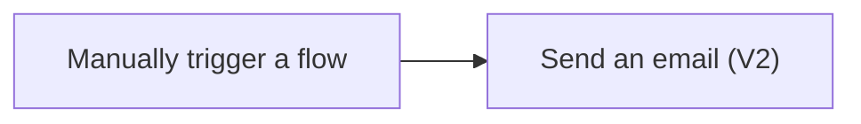

# Exercise 1: Send an email using your input


*Training illustration, not a Power Automate screenshot or evidence of a successful run.*

When a new task arrives, we often type the same notification again. Let a flow prepare that message from the input you enter, like ringing a doorbell and handing over a task slip.

> **License:** This exercise uses the Office 365 Outlook Standard connector. You need cloud-flow access and an authorised Microsoft 365 mailbox. It does not use Premium connectors; the organiser must confirm your service entitlements.

## Before you start

- Open [Power Automate](https://make.powerautomate.com) with your training account and select the environment specified by the instructor.
- Open Outlook for the same account and identify your own email address.
- Use an authorised Office 365 Outlook connection. Ask the instructor for help if the connection fails.



## Practice 1: Create a trigger with a task input

Create a manual trigger with one Text input that receives a value when you run the flow.

1. Select **Create → Instant cloud flow** in Power Automate.
2. Enter this flow name:

   ```text
   B2-MyFirstEmail
   ```

3. Select **Manually trigger a flow**, then **Create**.
4. Open the trigger. Select **Add an input → Text** and name the input:

   ```text
   TaskTitle
   ```

5. Check the input name. Continue to Practice 2 before saving: the flow also needs an action.

### Quick check

You can see the manual trigger and one `TaskTitle` input, and explain that its value will be supplied when you run the flow.

## Practice 2: Pass the input into an email

Use Dynamic content so the email changes with the task input.

1. Select **+ → Add an action** below the trigger. Search for:

   ```text
   Send an email (V2)
   ```

2. Select the action from **Office 365 Outlook**. Check the connector name: Outlook.com is a different service. If prompted, sign in with your training account.
3. In **To**, enter your own authorised training email. Leave **CC** and **BCC** empty.
4. In **Subject**, enter this prefix, add one space, then insert the **TaskTitle** token from **Manually trigger a flow**:

   ```text
   Training task:
   ```

   Open **Dynamic content** beside the field, or use **/ → Insert dynamic content** if available in your designer.

5. In **Body**, enter the following text, add one space, then insert the same **TaskTitle** token:

   ```text
   New training task:
   ```

   Do not type the word TaskTitle in place of the token.

6. Select **Save**. If your interface shows **Publish** and the flow is still a draft, follow the instructor-confirmed publishing step before testing. Resolve any save error first.

### Quick check

Subject and Body both contain the `TaskTitle` token from the trigger. To points to your own training mailbox.

## Practice 3: Verify two different runs

Test two inputs and inspect the actual emails to verify Dynamic content.

1. Select **Test → Manually → Test**. Check the connection and select **Continue** if prompted.
2. Enter this TaskTitle:

   ```text
   Prepare the weekly work summary
   ```

3. Select **Run flow**. After it finishes, open the latest run in **Run history** and inspect the **Inputs** of **Send an email (V2)**.
4. Check Outlook **Inbox** and **Junk Email**. Confirm that Subject and Body contain your input.
5. Test again with this TaskTitle:

   ```text
   Check the meeting document list
   ```

6. Verify that the second email contains the new input, not the first value.

### Quick check

You have two emails from two runs. Each email contains its corresponding TaskTitle and reaches your training mailbox.

## Troubleshooting

| Symptom | What to check |
|---|---|
| Email shows the word TaskTitle | Replace typed text with the Dynamic content token. |
| Save fails | Confirm there is a trigger and an action, and complete required fields. |
| Run succeeded but email is missing | Check To in action Inputs, then Inbox and Junk Email before running again. |
| Connection error | Check the account with your instructor; do not switch to an unauthorised personal account. |

## What you have learned

You selected a trigger, added an action and passed input into an actual email. Next, a Form submission will start the flow and supply values for Excel.

[Continue to Exercise 2](./02-forms-to-excel.md)

References: [Office 365 Outlook connector](https://learn.microsoft.com/connectors/office365/), [Instant cloud flows](https://learn.microsoft.com/power-automate/trigger-flow-with-button)
