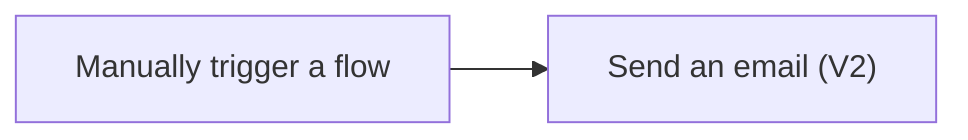

# Exercise 1: ส่ง Email ด้วย input ของเรา

เวลารับงานใหม่ เรามักพิมพ์ข้อความแจ้งเตือนแบบเดิม วันนี้ลองให้ flow เตรียมข้อความนั้นจาก input ที่เรากรอก เหมือนกดกริ่งแล้วส่งใบสั่งงานให้คนทำขั้นตอนต่อไป

> **License:** ใช้ Office 365 Outlook Standard connector ต้องมีสิทธิ์ cloud flow และ mailbox ที่ใช้ฝึก ไม่ใช้ Premium connector

## ก่อนเริ่ม

- เปิด [Power Automate](https://make.powerautomate.com) ด้วยบัญชีฝึก และเลือก environment ที่วิทยากรระบุ
- เปิด Outlook ของบัญชีฝึกเดียวกัน รู้ว่าอีเมลของตัวเองคืออะไร
- Connection ของ Office 365 Outlook ต้องใช้ mailbox ที่ได้รับอนุญาต หากเชื่อมต่อไม่ได้ให้แจ้งวิทยากร



## Practice 1: สร้าง Trigger ที่รับชื่องาน

**เป้าหมาย:** สร้าง manual trigger พร้อม Text input เพื่อรับค่าตอนผู้ใช้กด Run

1. ใน Power Automate เลือก **Create** → **Instant cloud flow**
2. ตั้งชื่อ flow:

   ```text
   B2-MyFirstEmail
   ```

3. เลือก **Manually trigger a flow** แล้วเลือก **Create**
4. เปิด trigger เลือก **Add an input** → **Text** แล้วตั้งชื่อ input:

   ```text
   TaskTitle
   ```

5. ตรวจว่าชื่อ input ตรงตามนี้ และยังอยู่ใน designer เดิม ทำ Practice 2 ต่อก่อน Save เพราะ flow ต้องมี action ด้วย

### Quick check

เห็น `Manually trigger a flow` และช่อง `TaskTitle` หนึ่งช่อง สามารถอธิบายได้ว่าค่านี้จะมาจากตอนกด Run

## Practice 2: ส่งค่าด้วย Dynamic content

**เป้าหมาย:** ใช้ TaskTitle ใน Email action เพื่อให้ข้อความเปลี่ยนตาม input

1. เลือก **+** ใต้ trigger → **Add an action** ค้นหา:

   ```text
   Send an email (V2)
   ```

2. เลือก action ของ **Office 365 Outlook** ตรวจชื่อ connector ก่อนเลือก เพราะ Outlook.com เป็นอีกบริการหนึ่ง หากมีขั้นตอน Sign in ให้ใช้บัญชีฝึก
3. ใน **To** ใส่อีเมลฝึกของตัวเอง เว้น **CC** และ **BCC** ว่าง ไม่ใช้ผู้รับภายนอก
4. ใน **Subject** ใส่ข้อความนี้:

   ```text
   Training task:
   ```

   วาง cursor ต่อท้าย เว้นหนึ่งช่อง แล้วเปิด **Dynamic content** เลือก `TaskTitle` จาก `Manually trigger a flow` ใน new designer อาจเปิดด้วย `/` → **Insert dynamic content** หรือปุ่ม Dynamic content ข้างช่อง
5. ใน **Body** ใส่ข้อความนี้:

   ```text
   มีงานใหม่สำหรับการฝึก
   ชื่องาน:
   ```

   เว้นหนึ่งช่องแล้วต่อท้ายด้วย token `TaskTitle` อย่าพิมพ์คำว่า TaskTitle เป็นข้อความแทน token
6. เลือก **Save** ถ้า interface แสดง **Publish** และ flow ยังเป็น draft ให้ทำตามขั้นตอนที่วิทยากรยืนยันแล้วว่าจำเป็น ก่อนเลือก Test อย่าข้าม error ที่หน้าบันทึก

### Quick check

ทั้ง Subject และ Body มี token `TaskTitle` จาก trigger และ To เป็น mailbox ฝึกของเรา

## Practice 3: พิสูจน์ค่าจากสอง run

**เป้าหมาย:** ทดสอบ input ต่างกันและตรวจ Email จริงเพื่อยืนยันว่า Dynamic content ทำงาน

1. เลือก **Test** → **Manually** → **Test** ตรวจ Connection ที่ใช้แล้วเลือก **Continue** หากมีหน้าถาม
2. กรอก `TaskTitle`:

   ```text
   เตรียมสรุปงานประจำสัปดาห์
   ```

3. เลือก **Run flow** รอ run จบ เปิด run ล่าสุดจาก **Run history** แล้วดู Inputs ของ `Send an email (V2)`
4. เปิด Outlook ตรวจ Inbox และ Junk Email ยืนยัน Subject และ Body มีค่าที่กรอก
5. กลับไป Test flow อีกครั้ง เปลี่ยน `TaskTitle` เป็น:

   ```text
   ตรวจรายการเอกสารสำหรับประชุม
   ```

6. ตรวจว่ารอบสองได้รับข้อความใหม่ที่ตรงกับ input ใหม่ ไม่ใช่ค่าจากรอบแรก

### Quick check

มี Email สองฉบับจากสอง run แต่ละฉบับมี TaskTitle ตรงกับ input และส่งถึง mailbox ฝึกที่ถูกต้อง

## ถ้าผลไม่ตรง

| อาการ | ลองตรวจ |
|---|---|
| เห็นคำว่า TaskTitle | กลับไปแทนข้อความด้วย Dynamic content token |
| Save ไม่ผ่าน | ต้องมี trigger และ action; ตรวจช่องที่บังคับกรอก |
| Succeeded แต่หา Email ไม่พบ | ตรวจ To ใน action Inputs และ Inbox/Junk ก่อนกดซ้ำ |
| Connection error | ตรวจบัญชีและขอความช่วยเหลือจากวิทยากร ไม่เปลี่ยนไปใช้บัญชีส่วนตัวโดยพลการ |

## สิ่งที่ได้และขั้นต่อไป

เราเลือกเหตุเริ่มงาน เพิ่ม action และส่งค่าจาก trigger ไปถึง Email จริงแล้ว ต่อไปเปลี่ยนเหตุเริ่มงานเป็นการส่ง Form และให้ flow เขียนข้อมูลลง Excel

[ไป Exercise 2: Forms → Excel](./02-forms-to-excel.md)

อ้างอิง: [Office 365 Outlook connector](https://learn.microsoft.com/connectors/office365/), [Instant cloud flows](https://learn.microsoft.com/power-automate/mobile/mobile-create-flow)
