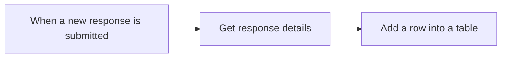

# Exercise 2: รับคำขอจาก Forms แล้วบันทึก Excel

แทนการอ่านคำขอแล้วคัดลอกลงตาราง เราจะให้ Microsoft Forms รับข้อมูล แล้ว Power Automate ส่งคำตอบลง Excel เหมือนรับใบสั่งงานหนึ่งใบแล้วลงทะเบียนหนึ่งรายการ

> **License:** ใช้ Microsoft Forms และ Excel Online (Business) Standard connectors พร้อม OneDrive for Business สำหรับเก็บ workbook ต้องมีสิทธิ์บริการและไฟล์ที่ใช้ฝึก ไม่ใช้ Premium connector ส่วน Email extension ใช้ Office 365 Outlook

## ก่อนเริ่ม

- เข้า Power Automate, Microsoft Forms และ OneDrive for Business ด้วยบัญชีฝึกเดียวกันได้
- ดาวน์โหลด [operations-request-tracker.xlsx](/downloads/operations-request-tracker.xlsx)
- แต่ละคนใช้ Form และ workbook ของตัวเอง ข้อมูลทั้งหมดเป็นตัวอย่างสมมติ
- ไม่ใช้ workbook ที่ Forms สร้างหรือ sync อัตโนมัติจากหน้า Responses เราต้องการเห็นแถวที่ flow นี้เป็นผู้เพิ่มโดยตรง



## Practice 1: เตรียมปลายทางที่ flow เขียนได้

**เป้าหมาย:** วาง workbook ส่วนตัวบน OneDrive for Business และระบุ Excel Table ที่จะรับคำตอบ

1. เปิด OneDrive for Business ของบัญชีฝึก สร้าง folder:

   ```text
   PowerAutomateTraining
   ```

2. Upload workbook ที่ดาวน์โหลด แล้วเปิดด้วย Excel for the web
3. เลือก worksheet:

   ```text
   Requests
   ```

4. คลิกเซลล์ในตาราง ดู **Table Design** หรือ **Table** แล้วตรวจ **Table Name**:

   ```text
   RequestsTable
   ```

5. ตรวจว่ามี column names ตามนี้ ไม่เปลี่ยนชื่อ:

   ```text
   RequestId,Title,Description,RequesterEmail,Category,Status
   ```

   Workbook เริ่มด้วยแถวว่างหนึ่งแถวเพื่อคง Table ไว้ แถวว่างนี้ไม่ใช่คำขอ ไม่ต้องกรอกข้อมูลลงไปเอง
6. ปิด workbook ก่อนให้ flow เขียน และรอ upload/sync เสร็จ

### Quick check

หา workbook ใน OneDrive ของตัวเองได้ และ Table Name เป็น RequestsTable พร้อมหกคอลัมน์ที่กำหนด

## Practice 2: สร้าง Form รับคำขอ

**เป้าหมาย:** สร้างแบบฟอร์มที่ให้คำตอบตรงกับข้อมูลที่ tracker ต้องการ

1. เปิด [Microsoft Forms](https://forms.office.com) → **New Form** หากมีหน้าชวน Draft with Copilot ให้ปิดแล้วสร้างคำถามเอง
2. ตั้งชื่อ Form:

   ```text
   Operations Practice Request
   ```

3. เพิ่มคำถาม **Text** แบบสั้น เปิด **Required**:

   ```text
   Task title
   ```

4. เพิ่ม **Text** เปิด **Long answer** และ **Required**:

   ```text
   Description
   ```

5. เพิ่ม **Text** แบบสั้น เปิด **Required**:

   ```text
   Requester email
   ```

   ระหว่างฝึกจะกรอกอีเมลฝึกของตัวเอง ไม่พึ่ง Responders' Email เพราะค่าดังกล่าวขึ้นกับการตั้งค่า Form
6. เพิ่ม **Choice** เปิด **Required** ปิด **Multiple answers** ตั้งชื่อ:

   ```text
   Category
   ```

   เพิ่มตัวเลือกทีละค่า:

   ```text
   Operations
   ```

   ```text
   Finance
   ```

   ```text
   HR
   ```

7. เปิด **Preview** ตรวจว่าคำถามครบสี่ข้อ ยังไม่ต้องส่ง response จนกว่า flow จะบันทึกเสร็จ

### Quick check

Form มีคำถามสี่ข้อชื่อถูกต้อง เปิด Required และ Category เลือกได้หนึ่งค่า

## Practice 3: เชื่อม response กับ Excel row

**เป้าหมาย:** ใช้ Response Id ดึงรายละเอียด แล้ว map คำตอบลง Excel Table

1. เปิด Power Automate → **Create** → **Automated cloud flow** ตั้งชื่อ:

   ```text
   B2-RecordOperationsRequest
   ```

2. เลือก Microsoft Forms trigger:

   ```text
   When a new response is submitted
   ```

3. เลือก **Create** ใน **Form Id** เลือก Form ที่สร้าง ถ้าหาไม่พบ ตรวจ connection ว่าเป็นเจ้าของ Form เดียวกันก่อนทำต่อ
4. เพิ่ม Microsoft Forms action:

   ```text
   Get response details
   ```

5. เลือก Form เดิมใน **Form Id** และใน **Response Id** เลือก Dynamic content `Response Id` จาก trigger อย่าพิมพ์เลข response เอง
6. เพิ่ม Excel Online (Business) action:

   ```text
   Add a row into a table
   ```

7. ตั้ง **Location** เป็น **OneDrive for Business** เลือก **Document Library** ส่วนตัวที่มีไฟล์ ใน **File** ใช้ folder picker เข้า PowerAutomateTraining แล้วเลือก operations-request-tracker.xlsx ชื่อ library อาจต่างตามภาษาบัญชี ให้ยืนยันจากไฟล์ที่พบ
8. ใน **Table** เลือก RequestsTable รอ schema โหลด หากเห็น **Advanced parameters** ให้เปิด **Show all** เพื่อแสดง column fields
9. Map ค่าตามตาราง โดยเลือก token จากขั้นตอนที่ระบุ ไม่พิมพ์ชื่อ token เป็นข้อความ:

   | Excel column | ค่า | แหล่งที่มา |
   |---|---|---|
   | RequestId | Response Id | When a new response is submitted |
   | Title | Task title | Get response details |
   | Description | Description | Get response details |
   | RequesterEmail | Requester email | Get response details |
   | Category | Category | Get response details |
   | Status | ข้อความคงที่ด้านล่าง | พิมพ์เอง |

   ใน **Status** กรอก:

   ```text
   Pending
   ```

10. เลือก **Save** ตรวจว่าไม่มี configuration error หากระบบมีขั้นตอน Publish ให้ใช้ตามที่วิทยากรตรวจไว้

### Quick check

Flow มี trigger หนึ่งตัวและ actions สองตัว ใช้ Form เดียวกันทั้งสองจุด และคำตอบมาจาก Get response details

## Practice 4: ส่งสองคำขอแล้วตรวจแถวจริง

**เป้าหมาย:** พิสูจน์ว่า response แต่ละรายการสร้างข้อมูลที่ตรงกับ input ใน tracker

1. เปิด Form → **Preview** กรอก [ข้อมูลทดสอบ A](../resources/sample-inputs.md#sample-a) แล้วเลือก **Submit**
2. เปิด flow details → **Run history** รอ run จบ เปิด `Get response details` และ `Add a row into a table` ตรวจ Inputs/Outputs
3. เปิด workbook หลัง run จบ หากยังไม่เห็นแถว ให้รอการแสดงผลแล้ว refresh ก่อน submit ซ้ำ การเขียน Excel อาจแสดงผลล่าช้าได้
4. ตรวจ Title, Description, RequesterEmail, Category และ Status เทียบกับ sample A รวมทั้ง RequestId เทียบกับ Response Id ใน run
5. ปิด workbook แล้วส่ง [ข้อมูลทดสอบ B](../resources/sample-inputs.md#sample-b) รอ run ที่สองจบก่อนเปิด Excel ใหม่
6. นับเฉพาะแถวที่ RequestId มีค่า ต้องเห็นสองรายการใหม่โดย RequestId ต่างกัน และข้อมูลแต่ละแถวตรงกับ response ของมัน

### Quick check

ส่ง Form สองครั้งหลัง Save ได้สอง run และสองแถวคำขอที่มี RequestId ไม่ซ้ำ แต่ละแถวมีข้อมูลถูกต้องและ Status เป็น Pending

## Optional: ส่ง Email หลังบันทึกสำเร็จ

ทำส่วนนี้เมื่อ core flow ผ่านแล้วเท่านั้น

**เป้าหมาย:** ยืนยันคำขอด้วย Email หลัง Excel action สำเร็จ

1. หลัง `Add a row into a table` เพิ่ม `Send an email (V2)` ของ Office 365 Outlook ปล่อย Run after เป็นค่าเริ่มต้นที่ทำหลัง action ก่อนหน้าสำเร็จ
2. ใน **To** เลือก `Requester email` จาก Get response details ใช้อีเมลฝึกของตัวเองใน Form เสมอ
3. ใน **Subject** ใส่ข้อความนี้ เว้นหนึ่งช่อง แล้วต่อด้วย token `Task title`:

   ```text
   Request recorded:
   ```

4. ใน **Body** ใส่ข้อความนี้ เว้นหนึ่งช่อง แล้วต่อด้วย token `Response Id`:

   ```text
   บันทึกคำขอฝึกแล้ว RequestId:
   ```

5. Save แล้วส่ง response ใหม่หนึ่งครั้ง ตรวจแถวใหม่ก่อน แล้วตรวจ Email ที่มี RequestId ตรงกัน

### Quick check

Response ใหม่นี้มีทั้งแถวที่ถูกต้องและ Email ยืนยัน ไม่ใช้สอง response ก่อนเพิ่ม action มาคาดว่าจะส่งย้อนหลัง

## เมื่อเจอปัญหา

| อาการ | ตรวจตามนี้ |
|---|---|
| ไม่มี run | ส่ง response ใหม่หลัง Save; ตรวจว่า flow เปิดใช้งานและ Form Id ถูกต้อง |
| ไม่พบ Table | ตรวจบัญชี, workbook, Table Name และสิทธิ์ไฟล์ ใช้ picker ไม่เดา path |
| Column มีชื่อคำถามแทนคำตอบ | เปลี่ยนข้อความเป็น Dynamic content จาก Get response details |
| Excel แสดงช้า | รอ run จบและ refresh; อย่า submit ซ้ำทันที |
| จำนวนแถวเกิน | ตรวจจำนวน submissions และ runs; แถวเริ่มต้นว่างไม่ใช่คำขอ และ resubmit run อาจเพิ่มซ้ำได้ |
| ข้อมูลผิด | เปรียบเทียบ Get response details Outputs กับ Excel action Inputs ทีละ field |

## สิ่งที่ได้

เราเปลี่ยน Trigger จากการกดปุ่มเป็น Form response และส่งข้อมูลข้ามบริการโดยดูแหล่งของ token ได้ ให้ทำกิจกรรมถัดไปตามที่วิทยากรแจ้ง และใช้ [คู่มือ ChatGPT](../guidebook/index.md) เมื่อถึงช่วงสุดท้าย

อ้างอิง: [Microsoft Forms connector](https://learn.microsoft.com/connectors/microsoftforms/), [Excel Online (Business)](https://learn.microsoft.com/connectors/excelonlinebusiness/), [Forms flow overview](https://learn.microsoft.com/power-automate/forms/overview)
