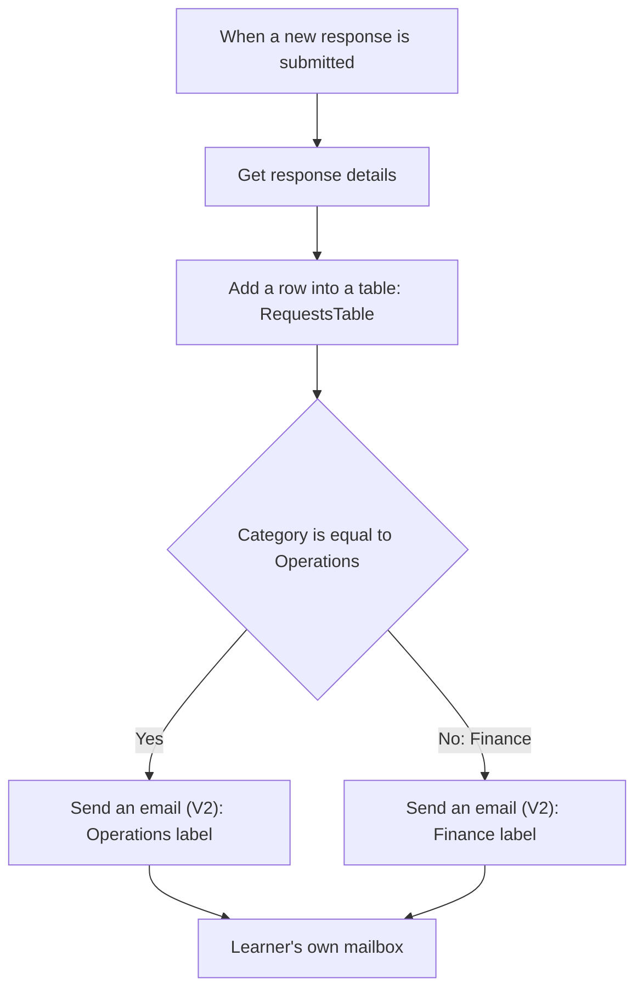

# Exercise 2: Smart Request Intake and Routing


*Training illustration, not a Power Automate screenshot or evidence of a successful run.*

Think of a reception desk that records a document before placing it in one of two trays. We will receive a Forms response, record it in Excel and use one Condition to choose an Operations or Finance email label. **Both routes send to your own mailbox.** Team names are fictional labels, not real recipients.

**10:45–12:00:** explanation 10 minutes → walkthrough 10 → guided practice 30 → tests 15 → recap/support 10. Work steadily. Use the Form and workbook from [pre-session preparation](../resources/section-2-preparation.md).

## Before you start

- Open your own Form with four required questions. Category must allow exactly one answer: Operations or Finance, with Other disabled.
- Have a personal workbook in OneDrive for Business with worksheet `Requests` and the six-column table `RequestsTable`.
- Confirm Power Automate, Microsoft Forms, Excel Online (Business) and Office 365 Outlook access with the organiser. These are Standard connectors, but the related service licences and permissions must be confirmed. No Premium connector or AI action is required.
- If your starting files or access are unavailable, ask for the prepared demonstration. Do not use a shared workbook for the whole class or use breaks to catch up.



## Practice 1: Retrieve a Form response

Retrieve the answers belonging to the response that triggered the flow.

1. Select **Create → Automated cloud flow**. Enter:

   ```text
   B2-RecordOperationsRequest
   ```

2. Select the Microsoft Forms trigger **When a new response is submitted**, then **Create**.
3. In **Form Id**, select your prepared `Operations Practice Request` Form. If names are duplicated, check its owner and open the Form to compare.
4. Add Microsoft Forms **Get response details**. Select the same **Form Id**.
5. In **Response Id**, insert **Response Id** from the trigger's Dynamic content. Do not type a response number or the words Response Id.

### Quick check

Both Form Id selections match. Response Id is a token from the trigger. If the Form is missing, check account and ownership with the instructor rather than guessing URLs or changing permissions.

## Practice 2: Record the request before routing

Map all six columns of the prepared Excel table.

1. After **Get response details**, add Excel Online (Business) **Add a row into a table**.
2. Select **Location: OneDrive for Business** and the training account's OneDrive **Document Library**. Use the **File** picker to select your uploaded workbook. Select this **Table**:

   ```text
   RequestsTable
   ```

3. Wait for the columns to load. If they do not appear, recheck File and Table. A worksheet name is not a table name.
4. Map the following Dynamic content. Status is the only fixed text value:

   | Excel column | Value / source |
   |---|---|
   | RequestId | Response Id from the trigger |
   | Title | Task title from Get response details |
   | Description | Description from Get response details |
   | RequesterEmail | Requester email from Get response details |
   | Category | Category from Get response details |
   | Status | Fixed text below |

   ```text
   Pending
   ```

### Quick check

The trigger supplies the ID; Get response details supplies the answers. Title uses the Task title token. Status remains Pending even after notification, because sending an email does not complete the requested work.

## Practice 3: Choose one of two routes

Use one Condition to select the email label that matches Category.

1. Add Built-in **Control → Condition** after the Excel action.
2. Configure one condition row: left value **Category** from Get response details; operator **is equal to**; right value:

   ```text
   Operations
   ```

3. In **True / If yes**, add Office 365 Outlook **Send an email (V2)**.
4. In **To**, enter your own authorised training email. Leave CC/BCC empty. The Form's Requester email is recorded only; it does not change the recipient in this exercise.
5. In **Subject**, enter this prefix, add one space, then insert **Task title** from Get response details:

   ```text
   [TRAINING][Operations]
   ```

6. Enter this **Body**, then insert **Task title** after Request and **Category** after Category:

   ```text
   Routed team: Operations (training only)
   Request:
   Category:
   ```

7. In **False / If no**, add another **Send an email (V2)**. Set To to the **same personal training mailbox**, leaving CC/BCC empty. Use this Subject prefix, one space and the Task title token:

   ```text
   [TRAINING][Finance]
   ```

   Use this Body and insert Task title and Category after their respective labels:

   ```text
   Routed team: Finance (training only)
   Request:
   Category:
   ```

8. **Save**. Ensure there is no extra email action after the Condition outside its branches: that would send an additional message every time.

**Why does No mean Finance?** The Form requires exactly one of two options. Any new category would also enter the No branch, so future expansion requires redesign. Do not add Switch, unknown-category handling or complex exceptions to today's required practice.

### Quick check

There is one Condition and one email action in each branch. Both recipients are your own mailbox. Trace the Operations and Finance paths before testing.

## Practice 4: Verify both routes

Match two runs to two Excel records and two emails.

1. Save and select **Test → Manually**. Open the Form's response page and submit [Sample A](../resources/sample-inputs.md#sample-a), using your training email as Requester email.
2. Open the completed run in **Run history**. Check Get response details, the Excel action and a **True / Yes** Condition result. The Operations email action should run; Finance should be **Skipped**.
3. Check the new RequestsTable row: correct Title and Category, with Status Pending. Check Inbox for one Operations-labelled email with the correct Task title.
4. Submit [Sample B](../resources/sample-inputs.md#sample-b). Check **False / No**, Finance email sent and Operations email action Skipped.
5. Check the second row and email. Across these two tests, expect **two populated rows with different RequestId values and two emails**. Exclude the initial blank row and any earlier runs.

| Test | Condition | Excel | Email in your own mailbox |
|---|---|---|---|
| A: Operations | True / Yes | Category Operations, Status Pending | [TRAINING][Operations] + Task title |
| B: Finance | False / No | Category Finance, Status Pending | [TRAINING][Finance] + Task title |

### Quick check

Trace one answer from Form → Excel → Condition → email and show evidence for both routes. Use the recap/support time to resolve issues; no additional features are required.

## Troubleshooting

| Symptom | Check / recovery |
|---|---|
| Form or File missing from picker | Check account and ownership with the instructor using [pre-session preparation](../resources/section-2-preparation.md). |
| Table missing | Reselect File and check RequestsTable; a worksheet alone is not enough. |
| Row or email has not arrived | Inspect running/failed runs before resubmitting. Excel changes can take time to appear. |
| Every request goes to Finance | Check the Category token, exact Operations value and spaces; confirm single-choice settings. |
| Email displays Task title literally | Replace typed text with the token from Get response details. |
| Excel succeeds but email fails | The row was already written. Inspect Outlook; resubmitting may create a duplicate row. Deduplication is not included. |
| Need a new workbook | Follow [reset instructions](../resources/downloads.md#reset), reselect File/Table and retest both routes. |

If your account cannot run the flow, trace the mapping and routes in the prepared demonstration. Record this as a walkthrough, not a completed learner run.

References: [Forms conditional email](https://learn.microsoft.com/power-automate/forms/how-to), [Forms scenarios](https://learn.microsoft.com/power-automate/forms/popular-scenarios), [Excel Online (Business)](https://learn.microsoft.com/connectors/excelonlinebusiness/). Documentation supports the design pattern, not readiness of your training tenant.
