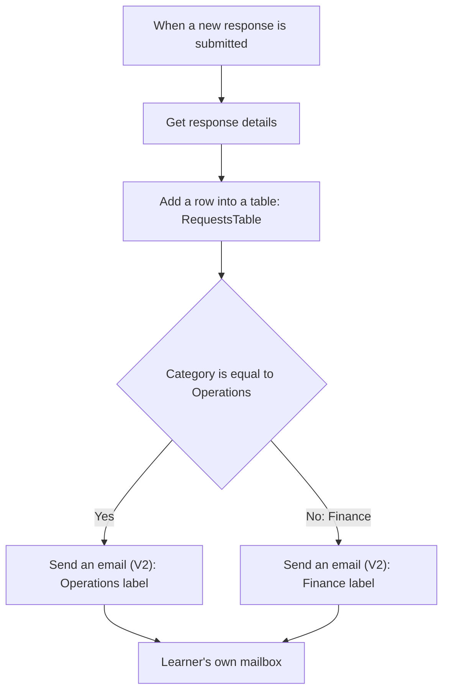

# Exercise 2: Smart Request Intake and Routing


Think of a reception desk that records a document before placing it in one of two trays. We will receive a Forms response, record it in Excel and use one Condition to choose an Operations or Finance email label. **Both routes send to your own mailbox.** Team names are fictional labels, not real recipients.

Use [pre-session preparation](../resources/section-2-preparation.md) to check account and app access. Prepare your personal Excel workbook in Practice 1, then create your Form in Practice 2.

## Before you start

- Open [Microsoft Forms](https://forms.office.com) with your training account. You will create your own Form in Practice 2.
- Confirm you can open OneDrive for Business and Excel for the web with the same training account. You will upload and check your workbook in Practice 1.
- Confirm Power Automate, Microsoft Forms, Excel Online (Business) and Office 365 Outlook access with the organiser. These are Standard connectors, but the related service licences and permissions must be confirmed. No Premium connector or AI action is required.
- If your starting files or access are unavailable, ask for the prepared demonstration. Do not use a shared workbook for the whole class or use breaks to catch up.



## Practice 1: Prepare your Excel workbook

<PracticeIllustration src="/images/practices/ex02-p01.webp" alt="A learner uploads a personal workbook to a cloud folder." />

Prepare a personal Excel Table in OneDrive for Business so the flow has a structured place to record each request.

1. Download [operations-request-tracker.xlsx](/downloads/operations-request-tracker.xlsx). Use your own copy, not a shared class workbook.
2. Open [Microsoft 365](https://www.microsoft365.com) with your training account, then open **OneDrive** from the app launcher. Create or reuse this folder:

   ```text
   PowerAutomateTraining
   ```

3. Upload the downloaded workbook into that folder. Open it in Excel for the web.
4. Check the worksheet **Requests** and the existing Excel Table **RequestsTable**. Confirm these six column headers, in this order:

   | RequestId | Title | Description | RequesterEmail | Category | Status |
   |---|---|---|---|---|---|

   The supplied workbook already contains the Table. Do not recreate it or rename its columns. A worksheet and an Excel Table are different: the flow will select **RequestsTable** within the file.
5. Leave the initial blank row empty. Do not type or import the sample requests into the tracker; the flow will add them during testing.
6. Close the workbook tab before building and testing the flow to avoid simultaneous manual edits. Keep the file in OneDrive for Business, not only on your computer.

### Quick check

Your personal `operations-request-tracker.xlsx` is in OneDrive for Business. It contains worksheet `Requests`, Table `RequestsTable` and the six unchanged columns, with no test requests entered. If a personal copy already exists, verify it instead of uploading a duplicate.

## Practice 2: Create your request Form {#practice-1-create-your-request-form}

<PracticeIllustration src="/images/practices/ex02-p02.webp" alt="A learner creates a request form with two category choices." />

Create a four-question Form that supplies the request details and one routing category.

1. In [Microsoft Forms](https://forms.office.com), select **New Form**. Enter this title:

   ```text
   Operations Practice Request
   ```

2. Select **Add new → Text**. Enter this question name, keep it as a short answer and turn **Required** on:

   ```text
   Task title
   ```

3. Add another **Text** question. Enter this name, then turn **Long answer** and **Required** on:

   ```text
   Description
   ```

4. Add another **Text** question. Enter this name, keep it as a short answer and turn **Required** on:

   ```text
   Requester email
   ```

   Use your own training email in the tests. Collecting it explicitly avoids relying on Responder email being available for every account.

5. Select **Add new → Choice**. Enter this question name and turn **Required** on:

   ```text
   Category
   ```

6. Enter exactly two options, one in each option field:

   - **First option**

     ```text
     Operations
     ```

   - **Second option**

     ```text
     Finance
     ```

   Keep **Multiple answers** off. Do not add an **Other** option; remove it if present. Each response must choose one of these two routes.

7. Open **Preview**. Check the four questions and confirm that Category allows only one selection. Return to editing when you have checked the layout. Forms saves your changes automatically.
8. Check with the instructor that response settings allow your training account to submit. Keep the Form available; you will submit the two test requests after building the flow.

### Quick check

Your own `Operations Practice Request` Form has four required questions: Task title, Description, Requester email and Category. Category offers only Operations or Finance, with one answer allowed. If you already have a personal copy, verify it against these steps rather than creating a duplicate.

## Practice 3: Retrieve a Form response {#practice-1-retrieve-a-form-response}

<PracticeIllustration src="/images/practices/ex02-p03.webp" alt="A learner opens a submitted response to retrieve its answers." />

Retrieve the answers belonging to the response that triggered the flow.

1. Select **Create → Automated cloud flow**. Enter:

   ```text
   B2-RecordOperationsRequest
   ```

2. Select the Microsoft Forms trigger **When a new response is submitted**, then **Create**.
3. Open **When a new response is submitted** to view its settings.
4. Check the Microsoft Forms connection below **Form Id**. If it shows **Not connected**, select **Change connection reference**.

   

   [Open the connection screenshot at full size](/images/exercise-02-change-forms-connection.png).

5. Select an existing connection for your training account, or select **+ Add new connection**, then **Sign in** with the same Microsoft 365 account you used to create the Form in Practice 2.

   > **💡 Already connected?** If the trigger already uses a valid connection for the correct training account, continue without creating another connection or signing in again.

6. Wait for the connection to finish, then return to the trigger. Open **Form Id** and select the `Operations Practice Request` Form you created in Practice 2.

   > **Form missing?** Recheck the connection account against the account that owns your Form, then reopen **Form Id**. If the Form still does not appear or sign-in fails, ask the instructor for help.

7. Select **+ → Add an action** below the trigger. Search for this Microsoft Forms **action**:

   ```text
   Get response details
   ```

   Select the action, use the same training-account connection and select the same **Form Id**.
8. In **Response Id**, insert **Response Id** from the trigger's Dynamic content. Do not type a response number or the words Response Id.

### Quick check

The Microsoft Forms connection uses the training account that owns your Form. Both Form Id selections match `Operations Practice Request`, and Response Id is a token from the trigger. If the Form is missing, check account and ownership with the instructor rather than guessing URLs or changing permissions.

## Practice 4: Record the request before routing {#practice-2-record-the-request-before-routing}

<PracticeIllustration src="/images/practices/ex02-p04.webp" alt="One incoming request is recorded in a spreadsheet row." />

Map all six columns of the prepared Excel table.

1. After **Get response details**, select **+ → Add an action**. Search for this Excel Online (Business) **action**:

   ```text
   Add a row into a table
   ```

   Select the action from **Excel Online (Business)**.
2. Select the workbook and Table in this order:

   1. **Location:** select **OneDrive for Business**.
   2. **Document Library:** select your training account's personal OneDrive library.
   3. **File:** use the folder picker to select the personal workbook uploaded in Practice 1.
   4. **Table:** select:

      ```text
      RequestsTable
      ```

3. Wait for the columns to load. If they do not appear, recheck File and Table. A worksheet name is not a table name.
4. Map the following Dynamic content. Status is the only fixed text value:

   | Excel column | Value / source |
   |---|---|
   | RequestId | Response Id from the trigger |
   | Title | Task title from Get response details |
   | Description | Description from Get response details |
   | RequesterEmail | Requester email from Get response details |
   | Category | Category from Get response details |
   | Status | Fixed text below |

   ```text
   Pending
   ```

### Quick check

The trigger supplies the ID; Get response details supplies the answers. Title uses the Task title token. Status remains Pending even after notification, because sending an email does not complete the requested work.

## Practice 5: Choose one of two routes {#practice-3-choose-one-of-two-routes}

<PracticeIllustration src="/images/practices/ex02-p05.webp" alt="A request follows one of two routes." />

Use one Condition to select the email label that matches Category.

1. Add the Built-in **Control → Condition** action after the Excel action.
2. Configure **one condition row**, from left to right:

   1. **Left value:** open **Dynamic content (⚡)**. Search for:

      ```text
      Category
      ```

      Under **Get response details**, select the **Category** token. Do not type Category into the condition field.
   2. **Operator:** select **is equal to**.
   3. **Right value:** type:

      ```text
      Operations
      ```

   Your completed condition row should look like this:

   <div class="condition-reference" role="figure" aria-label="Condition: Category dynamic content from Get response details is equal to the typed text Operations">
     <div><span class="subject-reference-label">Left value · insert token</span><div class="subject-reference-field"><span class="subject-reference-token">⚡ Category</span></div></div>
     <div><span class="subject-reference-label">Operator · select</span><div class="subject-reference-field">is equal to</div></div>
     <div><span class="subject-reference-label">Right value · type text</span><div class="subject-reference-field">Operations</div></div>
   </div>

   This asks: “Is the submitted Category Operations?” **True / Yes** uses Operations; **False / No** uses Finance.
3. In **True / If yes**, add the Office 365 Outlook **Send an email (V2)** action.

   > **💡 Outlook connection:** Use your existing training-account connection. To create one, select **+ Add new connection**. In the connection dialog, enter a **Connection name** such as the one below, choose **Office 365 (sign in as user)** under **Authentication type**, then select **Sign in** with your training account. A dialog that goes straight to **Sign in** uses the same account.

   ```text
   B2-Outlook
   ```

4. In **To**, enter your own training email. Leave **CC/BCC** empty. Both routes send to you.
5. In **Subject**, type this prefix and add **one space**, then insert **Task title** from **Get response details** using **Dynamic content (⚡)**:

   ```text
   [TRAINING][Operations]
   ```

   <div class="subject-reference" role="figure" aria-label="Operations Subject: typed prefix followed by the Task title dynamic content token">
     <span class="subject-reference-label">Subject</span>
     <div class="subject-reference-field"><span>[TRAINING][Operations]</span><span class="subject-reference-token">⚡ Task title</span></div>
   </div>

6. In **Body**, enter this text. Add one space after **Request:** and insert **Task title**; add one space after **Category:** and insert **Category**. Both tokens come from **Get response details**.

   ```text
   Routed team: Operations (training only)
   Request:
   Category:
   ```

   <div class="subject-reference" role="figure" aria-label="Operations Body with typed Routed team line, Request followed by Task title token, and Category followed by Category token">
     <span class="subject-reference-label">Body</span>
     <div class="subject-reference-field email-body-reference">
       <div>Routed team: Operations (training only)</div>
       <div>Request: <span class="subject-reference-token">⚡ Task title</span></div>
       <div>Category: <span class="subject-reference-token">⚡ Category</span></div>
     </div>
   </div>

   Highlighted items are inserted tokens. Type the surrounding text; select the tokens from Dynamic content.
7. In **False / If no**, add another **Send an email (V2)** action using the same Outlook connection. Set **To** to your own training email and leave **CC/BCC** empty.

   - **Subject:** type this prefix, add one space, then insert **Task title** from **Get response details**:

     ```text
     [TRAINING][Finance]
     ```

   - **Body:** enter this text, then insert **Task title** after Request and **Category** after Category, with one space before each token:

     ```text
     Routed team: Finance (training only)
     Request:
     Category:
     ```

   Your completed Finance email fields should look like this:

   <div class="email-reference" role="figure" aria-label="Finance email sent to your own training mailbox, with Finance Subject and Body containing Task title and Category dynamic content tokens">
     <div class="subject-reference"><span class="subject-reference-label">To</span><div class="subject-reference-field"><em>Your own training email address</em></div></div>
     <div class="subject-reference"><span class="subject-reference-label">Subject</span><div class="subject-reference-field"><span>[TRAINING][Finance]</span><span class="subject-reference-token">⚡ Task title</span></div></div>
     <div class="subject-reference"><span class="subject-reference-label">Body</span><div class="subject-reference-field email-body-reference"><div>Routed team: Finance (training only)</div><div>Request: <span class="subject-reference-token">⚡ Task title</span></div><div>Category: <span class="subject-reference-token">⚡ Category</span></div></div></div>
   </div>

8. **Save**. Ensure there is no extra email action after the Condition outside its branches: that would send an additional message every time.

**Why does No mean Finance?** The Form requires exactly one of two options. Any new category would also enter the No branch, so future expansion requires redesign. Do not add Switch, unknown-category handling or complex exceptions to today's required practice.

### Quick check

There is one Condition and one email action in each branch. Both recipients are your own mailbox. Trace the Operations and Finance paths before testing.

## Practice 6: Verify both routes {#practice-4-verify-both-routes}

<PracticeIllustration src="/images/practices/ex02-p06.webp" alt="Two submitted requests match two records and two route emails." />

Match two runs to two Excel records and two emails.

1. Save and select **Test → Manually**. Open the Form's response page and submit [Sample A](../resources/sample-inputs.md#sample-a), using your training email as Requester email.
2. Open the completed run in **Run history**. Check Get response details, the Excel action and a **True / Yes** Condition result. The Operations email action should run; Finance should be **Skipped**.
3. Check the new RequestsTable row: correct Title and Category, with Status Pending. Check Inbox for one Operations-labelled email with the correct Task title.
4. Submit [Sample B](../resources/sample-inputs.md#sample-b). Check **False / No**, Finance email sent and Operations email action Skipped.
5. Check the second row and email. Across these two tests, expect **two populated rows with different RequestId values and two emails**. Exclude the initial blank row and any earlier runs.

| Test | Condition | Excel | Email in your own mailbox |
|---|---|---|---|
| A: Operations | True / Yes | Category Operations, Status Pending | [TRAINING][Operations] + Task title |
| B: Finance | False / No | Category Finance, Status Pending | [TRAINING][Finance] + Task title |

### Quick check

Trace one answer from Form → Excel → Condition → email and show evidence for both routes. Ask for help with any incomplete step; no additional features are required.

## Troubleshooting

| Symptom | Check / recovery |
|---|---|
| Form or File missing from picker | Check account and ownership with the instructor using [pre-session preparation](../resources/section-2-preparation.md). |
| Table missing | Reselect File and check RequestsTable; a worksheet alone is not enough. |
| Row or email has not arrived | Inspect running/failed runs before resubmitting. Excel changes can take time to appear. |
| Every request goes to Finance | Check the Category token, exact Operations value and spaces; confirm single-choice settings. |
| Email displays Task title literally | Replace typed text with the token from Get response details. |
| Excel succeeds but email fails | The row was already written. Inspect Outlook; resubmitting may create a duplicate row. Deduplication is not included. |
| Need a new workbook | Follow [reset instructions](../resources/downloads.md#reset), reselect File/Table and retest both routes. |

If your account cannot run the flow, trace the mapping and routes in the prepared demonstration. Record this as a walkthrough, not a completed learner run.

References: [Create a Form](https://support.microsoft.com/en-us/forms/create-a-form-with-microsoft-forms), [Forms conditional email](https://learn.microsoft.com/power-automate/forms/how-to), [Forms scenarios](https://learn.microsoft.com/power-automate/forms/popular-scenarios), [Excel Online (Business)](https://learn.microsoft.com/connectors/excelonlinebusiness/), [Condition fields](https://learn.microsoft.com/power-automate/add-condition#add-a-condition), [Office 365 Outlook connections](https://learn.microsoft.com/connectors/office365/#creating-a-connection). Documentation supports the design pattern, not readiness of your training tenant.
