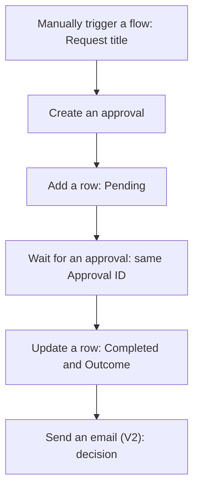
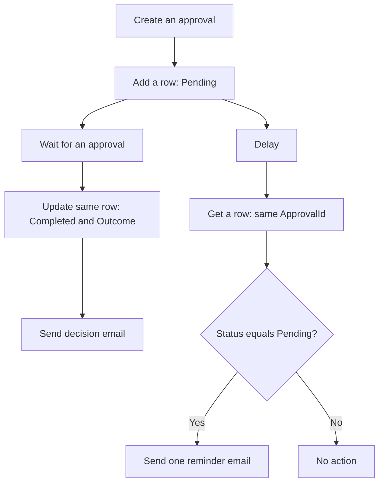

# Exercise 3: Complete an Approval, Then Add a Reminder


*Training illustration adapted from the course-review artwork, not a Power Automate screenshot or run evidence.*

A team needs a decision on an internal procedure. Think of an in-tray, a reviewer's desk and a decision register: the request arrives, a person makes the decision, and the register shows the result. Your flow will manage that handoff. You play requester and approver using your own training mailbox.

**Part 1:** complete and verify the approval, Excel record and result email. **Part 2:** improve that working flow with one reminder for the same approval. Finish Part 1 before changing the flow.

## Before you start

- Complete [Section 3 preparation](../resources/section-3-preparation.md). Use your own four-column workbook, independent of the morning exercise.
- Open [sample review briefs and inputs](/downloads/document-approval-sample-inputs.txt). You will enter only **Request title** when running the flow. No Form, upload or document link is needed.
- Confirm Approvals, Excel Online (Business), OneDrive for Business and Office 365 Outlook access with the organiser. Approvals, Excel Online (Business) and Office 365 Outlook are Standard connectors; the required Power Automate and Microsoft 365 entitlements, environment provisioning and permissions still need confirmation. Standard does not mean free access to every service.
- If approval access is unavailable, use the instructor's prepared demonstration and identify the expected results. Watching a demonstration does not complete your hands-on checkpoint.

## Part 1 — Complete the approval {#part-1-complete-the-approval}



### Practice 1 — Create one identifiable approval

**Target:** send one review request and obtain its Approval ID.

1. In Power Automate, create an **Instant cloud flow** using **Manually trigger a flow**. Name it:

   ```text
   B2-DocumentApproval
   ```

2. Add one **Text** input to the trigger. Name it:

   ```text
   Request title
   ```

3. Add **Approvals — Create an approval**. Use the current action, not a deprecated action or **Start and wait for an approval**. Set **Approval type** to **Approve/Reject - First to respond**.
4. In **Title**, insert the trigger's **Request title** Dynamic content token. In **Assigned to**, enter your own confirmed training email once. Leave approval notifications enabled.
5. In **Details**, enter this supplied review brief:

   ```text
   Training document review only.
   Handover checklist - complete: includes task, receiving role, handover owner and confirmation step. Approve this version.
   Handover checklist - missing owner: includes task and receiving role, but no handover owner. Reject this version.
   Review the version named in the request title. This decision does not publish a document.
   ```

6. Leave attachments and Item link empty. Continue building before testing.

**Checkpoint:** the trigger has one input, the approver is you, and the request has enough context for a human decision. **Create an approval** issues the request and returns its ID; it does not wait for the answer.

### Practice 2 — Record and wait for the same request

**Target:** connect the Pending Excel record and the waiting action to one Approval ID.

1. Immediately after **Create an approval**, add **Excel Online (Business) — Add a row into a table**. Use the File picker to select your personal approval tracker in OneDrive for Business and select **DocumentApprovalsTable**.
2. Map the four columns:

   | Excel column | Value source |
   |---|---|
   | `ApprovalId` | **Approval ID** from **Create an approval** |
   | `RequestTitle` | **Request title** from the manual trigger |
   | `Status` | Fixed text shown below |
   | `Decision` | Leave blank |

   Enter this fixed **Status** value:

   ```text
   Pending
   ```

3. Add **Approvals — Wait for an approval** after the Excel action. For **Approval ID**, select **Approval ID** from **Create an approval** again. Do not paste an ID from an earlier run or type the label as ordinary text.

**Checkpoint:** the row and waiting action use the same source token. The ID is like a claim ticket: it identifies which request this record and response belong to. The request title is a readable label, not the lookup key.

### Practice 3 — Record and communicate the decision

**Target:** complete the original record and notify the requester after the human response.

1. After **Wait for an approval**, add **Excel Online (Business) — Update a row**. Select the same workbook and **DocumentApprovalsTable**.
2. Select **ApprovalId** for **Key Column**. For **Key Value**, insert **Approval ID** from **Create an approval**. In **Status**, enter:

   ```text
   Completed
   ```

3. In **Decision**, insert **Outcome** from **Wait for an approval**. Leave the other update columns blank so their existing values remain. Use the top-level **Outcome**, not the **Responses** collection; this exercise needs no **Apply to each**.
4. Add **Office 365 Outlook — Send an email (V2)** after **Update a row**. Set **To** to your own training mailbox. Keep CC and BCC empty.
5. In **Subject**, type this prefix, add a space, then insert **Request title**:

   ```text
   [TRAINING][Decision]
   ```

6. In **Body**, enter the labels below. After each label, insert its indicated Dynamic content token; do not type the token's name as the value.

   ```text
   Request:
   Decision:
   Approval ID:
   ```

   | Label | Token |
   |---|---|
   | Request | Request title from trigger |
   | Decision | Outcome from Wait for an approval |
   | Approval ID | Approval ID from Create an approval |

7. Save the flow. Confirm that the update and result email remain directly after **Wait for an approval**, using their default successful-run dependency.

**Checkpoint:** both Approve and Reject use this single path. Completed means the review finished; `Decision` tells you its outcome. No action publishes or modifies a document.

### Practice 4 — Prove Part 1 before improving it {#practice-4-prove-part-1-before-improving-it}

**Target:** verify a complete record and result email for each decision.

1. Test manually with this **Request title**:

   ```text
   Handover checklist - complete
   ```

2. Before responding, refresh the workbook view until the new row shows **Pending** and a blank **Decision**. Ignore the template's blank starter row. Do not edit the workbook while the flow runs. Check that **Wait for an approval** is waiting.
3. Open the request in the original approval email or Power Automate's **Approvals** area. Check the title and choose **Approve**. Confirm **Completed**, **Approve**, the same Approval ID and the matching decision email.
4. After that run finishes, start a separate run with:

   ```text
   Handover checklist - missing owner
   ```

5. Observe its Pending row, then choose **Reject**. Confirm **Completed**, **Reject** and its decision email.

**Checkpoint:** two populated rows with distinct actual Approval IDs and two matching decision emails. Do not continue to Part 2 until both tests pass. The [expected-results workbook](/downloads/document-approval-expected-results.xlsx) is an illustration, not evidence that your flow ran.

## Part 2 — Add one reminder {#part-2-add-one-reminder}

Keep the original approval. A reminder is like a note beside the in-tray: it draws attention to the existing request, rather than placing a second request on the reviewer's desk.

On a small screen, scroll the diagram sideways to read both branches.

<div class="reminder-diagram">



</div>

### Practice 5 — Check the recorded status before reminding

**Target:** add a reminder branch that reads the status of the same request.

1. Make sure both Part 1 test runs have finished. In the designer, add a **parallel branch immediately after Add a row into a table**. Keep **Wait for an approval → Update a row → Send an email (V2)** together in the existing branch. Do not put the reminder after the Wait action.
2. In the new branch, add **Schedule — Delay**. Set **Count** to:

   ```text
   2
   ```

   Select **Minute** for **Unit**. This short interval is for training; it is not an approval timeout or a workplace service commitment.
3. After **Delay**, add **Excel Online (Business) — Get a row**. Select the same workbook and **DocumentApprovalsTable**. Set **Key Column** to **ApprovalId** and **Key Value** to **Approval ID** from **Create an approval**.
4. Add a **Condition** after **Get a row**. Select **Status from Get a row** on the left, **is equal to** in the middle, and enter on the right:

   ```text
   Pending
   ```

   Do not use Status from **Add a row into a table**: that is the original Pending value, not a fresh lookup.
5. Keep the default successful-run dependency between **Get a row** and **Condition**. Do not enable “run after failure” or treat an unreadable row as Pending.

**Checkpoint:** both branches start after the initial row is added. The reminder reads the stored status using this run's Approval ID; it does not create a new approval.

### Practice 6 — Send and verify one reminder

**Target:** remind an unanswered reviewer and complete the original request afterward.

1. Inside the Condition's **Yes / True** branch, add **Send an email (V2)**. Set **To** to the same training approver mailbox. Leave the **No / False** branch empty.
2. In **Subject**, enter this prefix, add a space, then insert **Request title**:

   ```text
   [TRAINING][Reminder]
   ```

3. In **Body**, enter the following text and insert **Request title** after Request and **Approval ID** from **Create an approval** after Approval ID:

   ```text
   Please review your existing training approval request.
   Request:
   Approval ID:
   Open the original approval email or Power Automate Approvals and find this request.
   If you have already responded, no further action is needed.
   ```

4. Save. Test the complete title again. Observe Pending, approve promptly and verify that the updated Completed row is visible well before the delay finishes. When both branches finish, inspect **Get a row** outputs, the Condition's **False** result and the skipped reminder action.
5. Run the missing-owner title again. Leave it unanswered until the reminder arrives. Check the row is still **Pending**, **Decision** is blank and no result email was sent. Verify there is only one approval request for this run.
6. Respond **Reject** to that original request. Verify the same row becomes **Completed / Reject** and receives one result email. Inspect Run history to confirm the reminder action ran once. Each new test creates its own new approval; a reminder does not.

**Checkpoint:** an already completed record suppresses the reminder; an unanswered request receives one reminder, then completes using its original Approval ID. The reminder email is an ordinary email with no new approval buttons.

## Read the result carefully

| What you observe | What it means |
|---|---|
| Pending, blank Decision | The flow has not recorded a completed response. |
| Completed, Approve | The reviewer approved the training request. |
| Completed, Reject | The reviewer rejected it; Completed does not mean approved. |
| Decision email arrived but run is still Running | The parallel Delay may still be finishing. Wait for both branches. |
| A reminder arrives close to a response | The status read and response can overlap; Excel writes may also take up to 30 seconds to appear. |

Excel is a familiar classroom tracker, but it is not an instantaneous approval-status service. A failed update can also leave the row Pending after a real response. Check the approval response and action results before assuming the person has not answered. This exercise does not guarantee suppression of every redundant reminder in a production workflow.

## Troubleshooting and reset

| Symptom | First check |
|---|---|
| Approval never arrives | Assigned to, notifications, account/environment access; check Approvals as well as email. Do not create repeated requests blindly. |
| No row found | Same workbook/table, exact case-sensitive `ApprovalId` key, current Create action's Approval ID; allow initial Excel write visibility. |
| Reminder sent after an early decision | Read Get a row output. Check Update a row succeeded and the Condition uses the fresh Status. Consider Excel write delay. |
| Get a row failed | Condition and reminder must be skipped. Fix the workbook/key; never enable sending on a failed lookup. |
| More than one result row per run | Confirm the decision action is Update a row, not another Add action. Do not resubmit a completed run. |
| Unexpected Apply to each | Use top-level Outcome from Wait for an approval, not Responses. |

1. Finish outstanding approvals or cancel your own training requests from **Approvals → Sent**, using the matching title and ID. Ask the instructor if Cancel is unavailable. Cancelling a flow run alone does not guarantee that its approval record is cancelled.
2. Cancel any remaining active training runs before resetting. Do not run multiple tests or manually edit the same workbook concurrently.
3. Upload [the reset workbook](/downloads/document-approval-tracker-reset.xlsx) as a new file in your personal OneDrive training folder.
4. Reselect **File** and **DocumentApprovalsTable** in **Add a row**, **Update a row** and, after Part 2, **Get a row**. Recheck all mappings and key values. Save and start a fresh test; old approval IDs belong to old runs.

You have practised a human decision, a traceable result and a conditional follow-up. Continue to [Exercise 4](./04-chatgpt-design-and-troubleshooting.md) for image-based review and controlled error repair.

## Technical references

- [Microsoft Learn: Create and Wait approval actions](https://learn.microsoft.com/troubleshoot/power-platform/power-automate/approvals/differences-between-flow-approval-actions)
- [Microsoft Learn: Standard approvals connector](https://learn.microsoft.com/en-us/connectors/approvals/)
- [Microsoft Learn: Excel Online (Business), row operations and limitations](https://learn.microsoft.com/en-us/connectors/excelonlinebusiness/)
