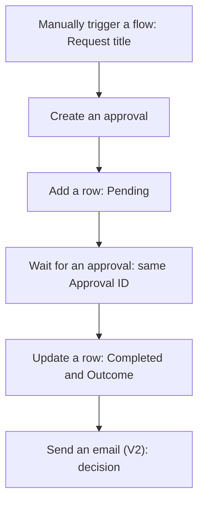
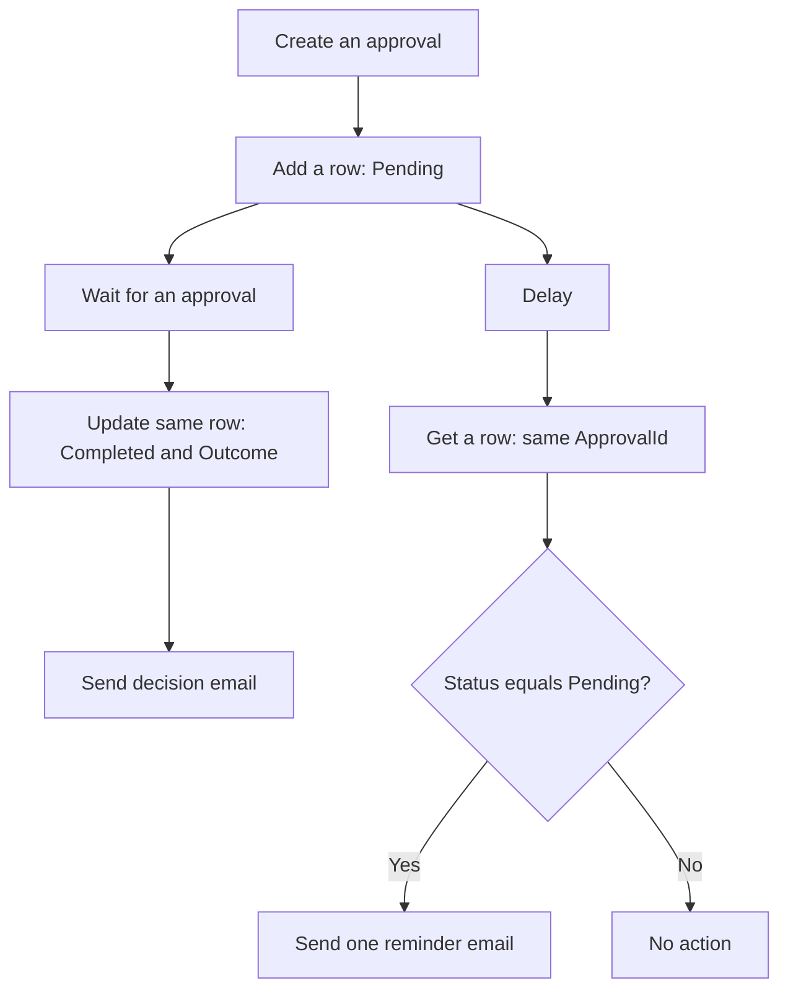

# Exercise 3: Complete an Approval, Then Add a Reminder


A team needs a decision on an internal procedure. Think of an in-tray, a reviewer's desk and a decision register: the request arrives, a person makes the decision, and the register shows the result. Your flow will manage that handoff. You play requester and approver using your own training mailbox.

**Part 1:** complete and verify the approval, Excel record and result email. **Part 2:** improve that working flow with one reminder for the same approval. Finish Part 1 before changing the flow.

## Before you start

- Check [Section 3 account and app access](../resources/section-3-preparation.md) with the instructor and select the agreed environment.
- Use your own training mailbox as requester and approver. Prepare a separate four-column tracker in Practice 1; the morning workbook is not used here.
- Approvals, Excel Online (Business) and Office 365 Outlook are Standard connectors. The organiser must confirm the required Power Automate and Microsoft 365 entitlements, environment provisioning and permissions.
- If approval access is unavailable, follow the instructor's prepared demonstration and identify the expected results. Watching a demonstration does not complete your hands-on checkpoint.

## Practice 1 — Prepare your approval tracker {#practice-1-prepare-your-approval-tracker}

<PracticeIllustration src="/images/practices/ex03-p01.webp" alt="An approval tracker is prepared in a personal cloud folder." />

Prepare a personal Excel Table to record each approval request and its decision.

1. Download [document-approval-tracker.xlsx](/downloads/document-approval-tracker.xlsx). Use your own copy, independent of the morning tracker.
2. Upload it to OneDrive for Business:
   1. Open [OneDrive for Business](https://www.microsoft365.com/launch/onedrive) with your training account.
   2. Open your personal training folder from Exercise 2.
   3. Upload the downloaded approval tracker.
   4. Open the uploaded workbook in Excel for the web.
3. Check the workbook:
   1. Open worksheet **Approvals**.
   2. Select a cell inside the existing Table and confirm its name is **DocumentApprovalsTable**.
   3. Confirm these four column headers, in this order:

      | ApprovalId | RequestTitle | Status | Decision |
      |---|---|---|---|

   The supplied workbook already contains the Table. Leave the intentional blank starter row empty. Do not rename the Table or columns, or enter sample results into this tracker.
4. Close the workbook's editing window.
5. Read [the sample review briefs and inputs](/downloads/document-approval-sample-inputs.txt). Both fictional versions will be included in the approval Details; the single **Request title** input identifies which version to review. No Form or business-document upload is needed.

   Keep the [reset workbook](/downloads/document-approval-tracker-reset.xlsx) for a clean start. The [expected-results workbook](/downloads/document-approval-expected-results.xlsx) contains fictional IDs for comparison only; do not connect the flow to it.

### Quick check

Your personal approval tracker is in OneDrive for Business with worksheet **Approvals**, Table **DocumentApprovalsTable**, the four unchanged columns and an empty starter row. Its editing window is closed, and you can read the two sample briefs.

## Part 1 — Complete the approval {#part-1-complete-the-approval}



### Practice 2 — Create one identifiable approval {#practice-1-—-create-one-identifiable-approval}

<PracticeIllustration src="/images/practices/ex03-p02.webp" alt="A reviewer receives one uniquely identified approval request." />

**Target:** send one review request and obtain its Approval ID.

1. In Power Automate, select **Create → Instant cloud flow**. Enter this flow name:

   ```text
   B2-DocumentApproval
   ```

2. Choose the **Manually trigger a flow** trigger, then select **Create**.
3. Open the trigger. Select **Add an input → Text** and name the input:

   ```text
   Request title
   ```

4. Add and configure the approval:
   1. Below the trigger, select **+ → Add an action**. Search for:

      ```text
      Create an approval
      ```

      Select the current **Approvals** action, not the deprecated action or **Start and wait for an approval**.
   2. **Approval type:** select **Approve/Reject - First to respond**.
   3. **Title:** enter this temporary text for the first save:

      ```text
      Training approval - temporary
      ```

   4. **Assigned to:** enter your own training email and confirm the recipient. Leave approval notifications enabled.

   > **💡 Approvals connection:** Use your training-account connection. When prompted, select **Sign in** with that account. Ask the instructor for help if connection or environment access fails.

5. Select **Save** and wait for it to finish. Do not test the flow yet.
6. Return to **Create an approval → Title**. Delete the temporary text, open **Dynamic content (⚡)** and select **Request title** under **Manually trigger a flow**.

   <div class="approval-field-stack" role="figure" aria-label="Approval Title with Request title token and Assigned to with your own training email"><div class="subject-reference"><span class="subject-reference-label">Title</span><div class="subject-reference-field"><span class="subject-reference-token">⚡ Request title</span></div></div><div class="subject-reference"><span class="subject-reference-label">Assigned to</span><div class="subject-reference-field"><em>Your own training email address</em></div></div></div>

   **Token source:** Manually trigger a flow. Insert Request title; do not type its name.
7. In **Details**, enter this supplied review brief:

   ```text
   Training document review only.
   Handover checklist - complete: includes task, receiving role, handover owner and confirmation step. Approve this version.
   Handover checklist - missing owner: includes task and receiving role, but no handover owner. Reject this version.
   Review the version named in the request title. This decision does not publish a document.
   ```

8. Leave attachments and Item link empty. Select **Save** again, then continue to Practice 3 before testing.

**Checkpoint:** the trigger has one input, the approver is you, and the request has enough context for a human decision. **Create an approval** issues the request and returns its ID; it does not wait for the answer.

### Practice 3 — Record and wait for the same request {#practice-2-—-record-and-wait-for-the-same-request}

<PracticeIllustration src="/images/practices/ex03-p03.webp" alt="The same approval identifier links a recorded row and a waiting request." />

**Target:** connect the Pending Excel record and the waiting action to one Approval ID.

1. Immediately after **Create an approval**, select **+ → Add an action**. Search for:

   ```text
   Add a row into a table
   ```

   Select the **Excel Online (Business)** action. Reuse your training-account Excel connection from Exercise 2, or sign in with that account when prompted.
2. Select the destination in this order:
   1. **Location:** select **OneDrive for Business**.
   2. **Document Library:** select your personal OneDrive library.
   3. **File:** use the folder picker to select the approval tracker uploaded in Practice 1.
   4. **Table:** select **DocumentApprovalsTable**. Wait for the four columns to load.
3. Map the four columns:
   1. **ApprovalId:** insert **Approval ID** from **Create an approval**.
   2. **RequestTitle:** insert **Request title** from **Manually trigger a flow**.
   3. **Status:** type:

      ```text
      Pending
      ```

   4. **Decision:** leave blank.

   <div class="approval-field-stack" role="figure" aria-label="Pending row field mappings with Approval ID and Request title tokens"><div class="subject-reference"><span class="subject-reference-label">ApprovalId</span><div class="subject-reference-field"><span class="subject-reference-token">⚡ Approval ID</span></div></div><div class="subject-reference"><span class="subject-reference-label">RequestTitle</span><div class="subject-reference-field"><span class="subject-reference-token">⚡ Request title</span></div></div><div class="subject-reference"><span class="subject-reference-label">Status</span><div class="subject-reference-field">Pending</div></div><div class="subject-reference"><span class="subject-reference-label">Decision</span><div class="subject-reference-field"><em>Leave blank</em></div></div></div>

   **Token sources:** Approval ID comes from Create an approval; Request title comes from the manual trigger.
4. After the Excel action, select **+ → Add an action**. Search for:

   ```text
   Wait for an approval
   ```

   Select the **Approvals** action and use the same training-account connection.
5. In **Approval ID**, insert **Approval ID** from **Create an approval**. Do not paste an ID from an earlier run or type the label as ordinary text.

   <div class="approval-field-stack" role="figure" aria-label="Wait for an approval uses the Approval ID token from Create an approval"><div class="subject-reference"><span class="subject-reference-label">Approval ID</span><div class="subject-reference-field"><span class="subject-reference-token">⚡ Approval ID</span></div></div></div>

   **Token source:** Create an approval. Use this same token for the Excel row and the waiting action.

**Checkpoint:** the row and waiting action use the same source token. The ID is like a claim ticket: it identifies which request this record and response belong to. The request title is a readable label, not the lookup key.

### Practice 4 — Record and communicate the decision {#practice-3-—-record-and-communicate-the-decision}

<PracticeIllustration src="/images/practices/ex03-p04.webp" alt="A human decision is recorded and communicated by email." />

**Target:** complete the original record and notify the requester after the human response.

1. After **Wait for an approval**, select **+ → Add an action**. Search for:

   ```text
   Update a row
   ```

   Select the **Excel Online (Business)** action. Select the same OneDrive Location, Document Library, approval tracker File and **DocumentApprovalsTable** as in Practice 3.
2. Configure the row update:
   1. **Key Column:** select **ApprovalId**.
   2. **Key Value:** insert **Approval ID** from **Create an approval**.
   3. **Status:** type:

      ```text
      Completed
      ```

   4. **Decision:** insert the top-level **Outcome** from **Wait for an approval**.
   5. Leave other update fields blank, or remove them from this action's field list. Their existing Excel values stay unchanged; do not delete workbook columns.

   <div class="approval-field-stack" role="figure" aria-label="Update a row key and decision mappings"><div class="subject-reference"><span class="subject-reference-label">Key Column</span><div class="subject-reference-field">ApprovalId</div></div><div class="subject-reference"><span class="subject-reference-label">Key Value</span><div class="subject-reference-field"><span class="subject-reference-token">⚡ Approval ID</span></div></div><div class="subject-reference"><span class="subject-reference-label">Status</span><div class="subject-reference-field">Completed</div></div><div class="subject-reference"><span class="subject-reference-label">Decision</span><div class="subject-reference-field"><span class="subject-reference-token">⚡ Outcome</span></div></div></div>

   **Tokens:** Approval ID → Create an approval; Outcome → Wait for an approval. Select Outcome, not Responses.
3. After **Update a row**, select **+ → Add an action**. Search for:

   ```text
   Send an email (V2)
   ```

   Select **Office 365 Outlook** and reuse your training-account connection; sign in when prompted.
4. In **To**, enter your own training email. Leave **CC/BCC** empty.
5. In **Subject**, type this prefix, add **one space**, then insert **Request title** from the manual trigger:

   ```text
   [TRAINING][Decision]
   ```

   <div class="approval-field-stack" role="figure" aria-label="Decision email Subject with Request title token"><div class="subject-reference"><span class="subject-reference-label">Subject</span><div class="subject-reference-field"><span>[TRAINING][Decision]</span><span class="subject-reference-token">⚡ Request title</span></div></div></div>

6. In **Body**, enter these labels, then add one space and the indicated token after each label:

   ```text
   Request:
   Decision:
   Approval ID:
   ```

   1. **Request:** insert **Request title** from the manual trigger.
   2. **Decision:** insert **Outcome** from **Wait for an approval**.
   3. **Approval ID:** insert **Approval ID** from **Create an approval**.

   <div class="subject-reference"><span class="subject-reference-label">Body</span><div class="subject-reference-field email-body-reference"><div>Request: <span class="subject-reference-token">⚡ Request title</span></div><div>Decision: <span class="subject-reference-token">⚡ Outcome</span></div><div>Approval ID: <span class="subject-reference-token">⚡ Approval ID</span></div></div></div>

7. Save the flow. Confirm the sequence remains **Wait for an approval → Update a row → Send an email (V2)**, using the default successful-run dependency.

**Checkpoint:** both Approve and Reject use this single path. Completed means the review finished; `Decision` tells you its outcome. No action publishes or modifies a document.

### Practice 5 — Prove Part 1 before improving it {#practice-4-prove-part-1-before-improving-it}

<PracticeIllustration src="/images/practices/ex03-p05.webp" alt="Approval and rejection test results are both verified." />

**Target:** verify a complete record and result email for each decision.

1. Select **Test → Manually → Test**. Check the training-account connections and continue. Enter this **Request title**, then select **Run flow**:

   ```text
   Handover checklist - complete
   ```

2. Observe the request before responding:
   1. Open or refresh the workbook view until the new row shows **Pending** and a blank **Decision**.
   2. Ignore the blank starter row and do not edit the workbook while the flow runs.
   3. In the run results, check that **Wait for an approval** is waiting.
3. Complete the approval:
   1. Open the request in its original approval email or Power Automate's **Approvals** area.
   2. Check the title and choose **Approve**.
   3. Confirm the same row becomes **Completed / Approve**, retains its Approval ID and has a matching decision email.
4. After that run finishes, start a separate run with:

   ```text
   Handover checklist - missing owner
   ```

5. Verify the rejection:
   1. Observe its Pending row before responding.
   2. Open that request and choose **Reject**.
   3. Confirm **Completed / Reject**, the same Approval ID and its matching decision email.

**Checkpoint:** two populated rows with distinct actual Approval IDs and two matching decision emails. Do not continue to Part 2 until both tests pass. The [expected-results workbook](/downloads/document-approval-expected-results.xlsx) is an illustration, not evidence that your flow ran.

## Part 2 — Add one reminder {#part-2-add-one-reminder}

Keep the original approval. A reminder is like a note beside the in-tray: it draws attention to the existing request, rather than placing a second request on the reviewer's desk.

On a small screen, scroll the diagram sideways to read both branches.

   <div class="reminder-diagram">



</div>

### Practice 6 — Check the recorded status before reminding {#practice-5-—-check-the-recorded-status-before-reminding}

<PracticeIllustration src="/images/practices/ex03-p06.webp" alt="The current recorded status is checked before a reminder." />

**Target:** add a reminder branch that reads the status of the same request.

1. Make sure **both Part 1 runs from Practice 5 have finished**. Open the **flow designer** and add the reminder branch:
   1. <span class="branch-action-badge">Right-click <strong>+</strong> on the arrow</span> between **Add a row into a table** and **Wait for an approval**.
   2. Select **Add a parallel branch**.
   3. In the action pane that opens, search for:

      ```text
      Delay
      ```

      Select the **Schedule** action.
   4. **Count:** enter:

      ```text
      2
      ```

   5. **Unit:** select:

      ```text
      Minute
      ```

   Keep **Wait for an approval → Update a row → Send an email (V2)** together in the existing branch. The reminder starts **after Add a row into a table**, before the approval wait, as shown in the Part 2 diagram. The two-minute delay is for training, not an approval timeout or workplace service commitment.

   > **💡 Finding the branch control:** Add a parallel branch is in the **+** menu. If action search is already open, close it and **right-click +** on the arrow. See [Microsoft Learn's parallel-branch steps](https://learn.microsoft.com/en-us/power-automate/parallel-modern-approvals#insert-a-parallel-branch-approval-action-for-the-sales-team).

2. After Delay, select **+ → Add an action**. Search for:

   ```text
   Get a row
   ```

   Select the **Excel Online (Business)** action and reuse the training-account connection.
3. Configure the lookup:
   1. Select the same OneDrive Location, Document Library, approval tracker File and **DocumentApprovalsTable**.
   2. **Key Column:** select **ApprovalId**.
   3. **Key Value:** insert **Approval ID** from **Create an approval**.

   <div class="approval-field-stack" role="figure" aria-label="Reminder lookup uses ApprovalId and the original Approval ID token"><div class="subject-reference"><span class="subject-reference-label">Key Column</span><div class="subject-reference-field">ApprovalId</div></div><div class="subject-reference"><span class="subject-reference-label">Key Value</span><div class="subject-reference-field"><span class="subject-reference-token">⚡ Approval ID</span></div></div></div>

   ::: info Token source
   **Approval ID** comes from **Create an approval** and identifies the current approval’s row.
   :::
4. After Get a row, select **+ → Add an action**. Search for:

   ```text
   Condition
   ```

   Select the Built-in **Control** action. Configure one row:
   1. **Left value:** insert **Status** from **Get a row** using **Dynamic content (⚡)**.
   2. **Operator:** select **is equal to**.
   3. **Right value:** type:

      ```text
      Pending
      ```

   <div class="condition-reference" role="figure" aria-label="Reminder Condition: fresh Status token from Get a row is equal to typed text Pending">
     <div><span class="subject-reference-label">Left value · insert token</span><div class="subject-reference-field"><span class="subject-reference-token">⚡ Status</span></div></div>
     <div><span class="subject-reference-label">Operator · select</span><div class="subject-reference-field">is equal to</div></div>
     <div><span class="subject-reference-label">Right value · type text</span><div class="subject-reference-field">Pending</div></div>
   </div>

   ::: warning Use the latest status
   Select **Status from Get a row**. Status from Add a row into a table contains the original Pending value, not a fresh lookup.
   :::
5. Keep the default successful-run dependency between **Get a row** and **Condition**. Do not enable “run after failure” or treat an unreadable row as Pending.

**Checkpoint:** both branches start after the initial row is added. The reminder reads the stored status using this run's Approval ID; it does not create a new approval.

### Practice 7 — Send and verify one reminder {#practice-6-—-send-and-verify-one-reminder}

<PracticeIllustration src="/images/practices/ex03-p07.webp" alt="One reminder refers to the original approval request." />

**Target:** remind an unanswered reviewer and complete the original request afterward.

1. Inside the Condition's **Yes / True** branch, select **Add an action**. Search for:

   ```text
   Send an email (V2)
   ```

   Select the **Office 365 Outlook** action and reuse the training-account connection. Set **To** to your own training approver email. Leave CC/BCC and the **No / False** branch empty.
2. In **Subject**, type this prefix, add **one space**, then insert **Request title** from the manual trigger:

   ```text
   [TRAINING][Reminder]
   ```

   <div class="approval-field-stack" role="figure" aria-label="Reminder email Subject with original Request title token"><div class="subject-reference"><span class="subject-reference-label">Subject</span><div class="subject-reference-field"><span>[TRAINING][Reminder]</span><span class="subject-reference-token">⚡ Request title</span></div></div></div>

3. In **Body**, enter this text, then insert the tokens:

   ```text
   Please review your existing training approval request.
   Request:
   Approval ID:
   Open the original approval email or Power Automate Approvals and find this request.
   If you have already responded, no further action is needed.
   ```

   1. After **Request:** add one space and insert **Request title** from the manual trigger.
   2. After **Approval ID:** add one space and insert **Approval ID** from **Create an approval**.

   <div class="subject-reference"><span class="subject-reference-label">Body</span><div class="subject-reference-field email-body-reference"><div>Please review your existing training approval request.</div><div>Request: <span class="subject-reference-token">⚡ Request title</span></div><div>Approval ID: <span class="subject-reference-token">⚡ Approval ID</span></div><div>Open the original approval email or Power Automate Approvals and find this request.</div><div>If you have already responded, no further action is needed.</div></div></div>

4. Save. Test early completion using:

   ```text
   Handover checklist - complete
   ```

   1. Observe the Pending row, then approve promptly.
   2. Confirm the same row becomes Completed and is visible well before the Delay finishes.
   3. Wait for both branches to finish. Inspect **Get a row** outputs, the Condition's **False** result and the skipped reminder action.
5. Start a separate unanswered-request test using:

   ```text
   Handover checklist - missing owner
   ```

   1. Leave it unanswered until the reminder arrives.
   2. Confirm the row remains **Pending**, Decision is blank and no result email has been sent.
   3. Confirm there is only one approval request for this run.
6. Complete that original request:
   1. Open the original approval and respond **Reject**.
   2. Verify the same row becomes **Completed / Reject** and one matching result email arrives.
   3. Inspect Run history to confirm the reminder action ran once.

   Each new test creates its own new approval; a reminder does not.

**Checkpoint:** an already completed record suppresses the reminder; an unanswered request receives one reminder, then completes using its original Approval ID. The reminder email is an ordinary email with no new approval buttons.

## Read the result carefully

| What you observe | What it means |
|---|---|
| Pending, blank Decision | The flow has not recorded a completed response. |
| Completed, Approve | The reviewer approved the training request. |
| Completed, Reject | The reviewer rejected it; Completed does not mean approved. |
| Decision email arrived but run is still Running | The parallel Delay may still be finishing. Wait for both branches. |
| A reminder arrives close to a response | The status read and response can overlap; Excel writes may also take up to 30 seconds to appear. |

Excel is a familiar classroom tracker, but it is not an instantaneous approval-status service. A failed update can also leave the row Pending after a real response. Check the approval response and action results before assuming the person has not answered. This exercise does not guarantee suppression of every redundant reminder in a production workflow.

## Troubleshooting and reset

| Symptom | First check |
|---|---|
| Approval never arrives | Assigned to, notifications, account/environment access; check Approvals as well as email. Do not create repeated requests blindly. |
| No row found | Same workbook/table, exact case-sensitive `ApprovalId` key, current Create action's Approval ID; allow initial Excel write visibility. |
| Reminder sent after an early decision | Read Get a row output. Check Update a row succeeded and the Condition uses the fresh Status. Consider Excel write delay. |
| Get a row failed | Condition and reminder must be skipped. Fix the workbook/key; never enable sending on a failed lookup. |
| More than one result row per run | Confirm the decision action is Update a row, not another Add action. Do not resubmit a completed run. |
| Unexpected Apply to each | Use top-level Outcome from Wait for an approval, not Responses. |

1. Finish outstanding approvals or cancel your own training requests from **Approvals → Sent**, using the matching title and ID. Ask the instructor if Cancel is unavailable. Cancelling a flow run alone does not guarantee that its approval record is cancelled.
2. Cancel any remaining active training runs before resetting. Do not run multiple tests or manually edit the same workbook concurrently.
3. Upload [the reset workbook](/downloads/document-approval-tracker-reset.xlsx) as a new file in your personal OneDrive training folder.
4. Reselect **File** and **DocumentApprovalsTable** in **Add a row**, **Update a row** and, after Part 2, **Get a row**. Recheck all mappings and key values. Save and start a fresh test; old approval IDs belong to old runs.

You have practised a human decision, a traceable result and a conditional follow-up. Continue to [Exercise 4](./04-chatgpt-design-and-troubleshooting.md) for image-based review and controlled error repair.

## Technical references

- [Microsoft Learn: Create and Wait approval actions](https://learn.microsoft.com/troubleshoot/power-platform/power-automate/approvals/differences-between-flow-approval-actions)
- [Microsoft Learn: Standard approvals connector](https://learn.microsoft.com/en-us/connectors/approvals/)
- [Microsoft Learn: Excel Online (Business), row operations and limitations](https://learn.microsoft.com/en-us/connectors/excelonlinebusiness/)
