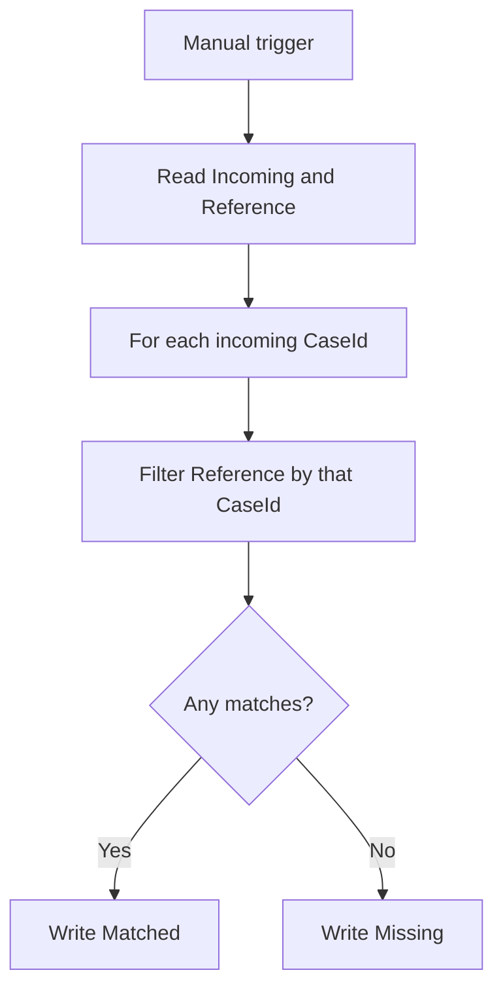

# Optional A: Compare Two Lists and Find Missing Records


Checking incoming cases against an agreed list is like checking guests against an invitation list. Build a flow that records whether each incoming CaseId is **Matched** or **Missing**. Missing means absent from this reference list; a person still decides what to do about it.

This is voluntary after-class practice. Start here even if you have not completed the other exercises. Work at your own pace using the supplied fictional data.

> **Access:** Use an authorised organisational account with Power Automate cloud flows, OneDrive for Business and Excel for the web. Excel Online (Business) is a Standard connector; the organiser must confirm licences, environment and permissions. No Premium connector or AI action is required. If access fails, stop at that step and ask your training contact; supplied results are for comparison, not proof of a completed flow.



## Practice 1: Prepare your comparison workbook

<PracticeIllustration src="/images/practices/opt-a-p01.webp" alt="Two source lists and an empty results workbook are prepared." />

Prepare your own data and empty results table before building the flow.

1. Open [Power Automate](https://make.powerautomate.com/) with your training account and select the environment agreed with the organiser. Confirm that you can create a cloud flow.
2. Download [list-comparison.xlsx](/downloads/list-comparison.xlsx). Also keep the [reset copy](/downloads/list-comparison-reset.xlsx), [illustrative expected results](/downloads/list-comparison-expected-results.xlsx) and [sample inputs](/downloads/optional-practice-inputs.txt) available. Connect the flow only to your personal starter workbook.
3. Open [Microsoft 365](https://www.microsoft365.com/), then **Apps → OneDrive** with the same account. Create a personal folder named:

   ```text
   PowerAutomateOptional
   ```

4. Upload the starter workbook into that folder and open it in Excel for the web. Verify these existing Tables:

   | Worksheet | Table | Columns | Starting data |
   |---|---|---|---|
   | Incoming | IncomingTable | CaseId | C001, C002 |
   | Reference | ReferenceTable | CaseId | C001, C003 |
   | Results | ComparisonResultsTable | CaseId, MatchStatus | One empty starter row |

5. Keep the IDs exactly as supplied: text, uppercase, unique and nonblank. Leave the Results starter row empty. Do not import the expected results.
6. Close the workbook's editing tab. Use one personal workbook, one test run at a time and no simultaneous manual edits.

### Quick check

You can open your personal workbook in OneDrive. All three Table names and columns match the table above; Results has no populated records.

## Practice 2: Read both lists

<PracticeIllustration src="/images/practices/opt-a-p02.webp" alt="A learner reads both source lists." />

Read two separate arrays: the incoming cases and the authoritative reference.

1. In Power Automate select **Create → Instant cloud flow**. Name the flow:

   ```text
   B2-Optional-A-CompareLists
   ```

2. Select **Manually trigger a flow**, then **Create**. Add no trigger inputs.
3. Select **+ → Add an action**. Search for the Excel Online (Business) action:

   ```text
   List rows present in a table
   ```

4. Sign in to an Excel Online (Business) connection with the account holding your workbook. Reuse a valid connection for that account. Select **Location: OneDrive for Business**, your personal **Document Library**, the uploaded **File** and **Table: IncomingTable**.
5. Use the action's **… → Rename** command. Enter this exact name before adding expressions:

   ```text
   Read_Incoming
   ```

6. Add the same Excel action below it. Select the same File and **ReferenceTable**, then rename it:

   ```text
   Read_Reference
   ```

### Quick check

Read_Incoming selects IncomingTable; Read_Reference selects ReferenceTable. Their `value` outputs will contain the rows. These tiny lists do not need pagination or a query filter.

## Practice 3: Find matching records

<PracticeIllustration src="/images/practices/opt-a-p03.webp" alt="A learner compares identifiers across two lists." />

For each incoming ID, look for the same ID in Reference.

1. After Read_Reference, add the Built-in **Control → Apply to each** action. Rename it:

   ```text
   For_each_incoming
   ```

2. In its array input, select **value** from **Read_Incoming** using Dynamic content. Leave **Concurrency Control** off in the loop's Settings so Excel writes remain sequential.
3. **Inside the loop**, add the **Data Operation → Filter array** action. Rename it:

   ```text
   Find_reference
   ```

4. In **From**, insert **value** from **Read_Reference**. In **Filter Query**, select **Edit in advanced mode** and paste this complete query, including its leading `@`:

   ```text
   @equals(item()?['CaseId'],items('For_each_incoming')?['CaseId'])
   ```

   `item()` is the reference row being checked. `items('For_each_incoming')` is the incoming row held by the outer loop. Keep the action names and column spelling exactly as shown. Filter array text matching is case-sensitive; this exercise uses consistently cased IDs.
5. After Find_reference, still inside the loop, add **Control → Condition**. Click the left field, open **Expression (fx)**, paste the following **without** a leading `@`, then select **Add**:

   ```text
   length(body('Find_reference'))
   ```

6. Select **is greater than** in the middle field. In the right field, use **Expression (fx)** to insert the number:

   ```text
   0
   ```

   <div class="condition-reference" role="figure" aria-label="Condition: length of Find_reference output is greater than numeric zero">
     <div><span class="subject-reference-label">Left · expression</span><div class="subject-reference-field"><span class="subject-reference-token">fx length(…)</span></div></div>
     <div><span class="subject-reference-label">Operator</span><div class="subject-reference-field">is greater than</div></div>
     <div><span class="subject-reference-label">Right · number</span><div class="subject-reference-field"><span class="subject-reference-token">fx 0</span></div></div>
   </div>

### Quick check

The loop reads incoming rows; Filter array searches Reference. The Condition asks whether the filtered array contains at least one match. No nested Apply to each is needed.

## Practice 4: Record Matched or Missing

<PracticeIllustration src="/images/practices/opt-a-p04.webp" alt="Matched and missing records are recorded separately." />

Write one result for the current incoming record.

1. In **True / If yes**, add the Excel Online (Business) action:

   ```text
   Add a row into a table
   ```

2. Select the same workbook and **ComparisonResultsTable**. In **CaseId**, use **Expression (fx)** to insert:

   ```text
   items('For_each_incoming')?['CaseId']
   ```

3. In **MatchStatus**, type:

   ```text
   Matched
   ```

   <div class="subject-reference" role="figure" aria-label="Matched result fields: CaseId is an expression token; MatchStatus is typed text Matched">
     <span class="subject-reference-label">CaseId</span><div class="subject-reference-field"><span class="subject-reference-token">fx items('For_each_incoming')?['CaseId']</span></div>
     <span class="subject-reference-label">MatchStatus</span><div class="subject-reference-field">Matched</div>
   </div>

4. In **False / If no**, add another **Add a row into a table** action with the same File, Table and CaseId expression. In **MatchStatus**, type:

   ```text
   Missing
   ```

5. Save the flow. Keep both write actions inside their respective branches and inside For_each_incoming. Do not add a third write action after the Condition.

### Quick check

Each incoming record takes exactly one branch. Both branches record the incoming CaseId, and only their fixed MatchStatus values differ.

## Practice 5: Verify results and reset

<PracticeIllustration src="/images/practices/opt-a-p05.webp" alt="Comparison results are verified and the workbook can be reset." />

Check the actual table contents as well as the run.

1. Select **Test → Manually → Test**. Confirm the Excel connection, select **Continue** when shown, then **Run flow**.
2. Open the completed run from the test panel or from **My flows → your flow → Run history**. Expand For_each_incoming. C001 should have one filtered match and a True condition; C002 should have zero matches and a False condition.
3. Open Results in Excel. Ignore the initial blank row and verify exactly these two populated rows:

   | CaseId | MatchStatus |
   |---|---|
   | C001 | Matched |
   | C002 | Missing |

4. Compare with the expected-results workbook. C003 is a reference-only record and creates no result: the loop starts from Incoming.
5. Before another test, wait for the run to finish and close Excel. Upload the reset workbook as a new personal file. Reselect **File** and **Table** in both read actions and both write actions, then save and retest. Each run appends results; this flow does not deduplicate earlier results.

### Quick check

Your completed run and two populated result rows agree. You can explain why C003 has no output and why a reset is needed before counting a second test.

## Troubleshooting and cleanup

| Symptom | Check |
|---|---|
| Workbook or Table missing | Recheck the Excel connection account and File picker. A worksheet is not an Excel Table. |
| Expression cannot find an action | Rename the actions exactly as shown, then reinsert the expression. |
| Every record is Missing | Check that From uses Read_Reference value, the outer loop uses Read_Incoming value, and IDs have matching case and no spaces. |
| An unwanted nested loop appears | Remove the accidental nested loop and use the supplied expression for the current incoming CaseId. |
| Extra result rows | Inspect earlier runs and both Condition branches before resetting. |

When finished, turn off the practice flow in **My flows**. Keep your own sample workbook for reference. This small comparison excludes duplicates, blank keys and differences in amounts or descriptions; these need separate design decisions before workplace use.

References: [Filter array](https://learn.microsoft.com/power-automate/data-operations#use-the-filter-array-action), [expression functions](https://learn.microsoft.com/azure/logic-apps/workflow-definition-language-functions-reference), [Excel Online (Business)](https://learn.microsoft.com/connectors/excelonlinebusiness/).
