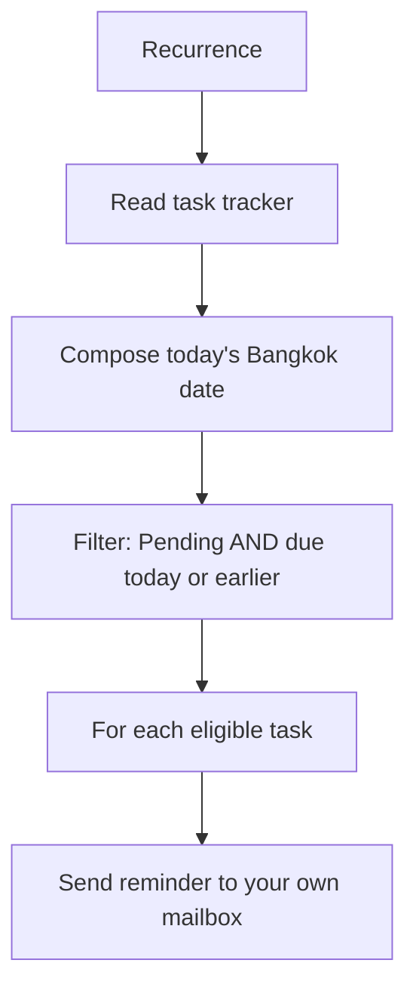

# Optional B: Due-Date Reminders for Pending Tasks


A calendar alarm draws attention to work that needs doing. Build a flow that checks a small task list and emails you about Pending tasks due today or earlier. This is a scheduled task reminder, separate from the approval reminder in Exercise 3.

This is voluntary after-class practice. All preparation is included below; other exercises are optional background reading.

> **Access:** Use your authorised organisational account, agreed Power Automate environment, OneDrive for Business, Excel for the web and Outlook mailbox. Excel Online (Business) and Office 365 Outlook are Standard connectors; licences, cloud-flow access and permissions must be confirmed. No Premium connector or AI action is required. If an app or connection is unavailable, stop there and contact your training contact.



## Practice 1: Prepare your task tracker and dates

<PracticeIllustration src="/images/practices/opt-b-p01.webp" alt="A task tracker and practice dates are prepared." />

Prepare four test cases relative to the day you actually practise.

1. Open [Power Automate](https://make.powerautomate.com/) and select the environment agreed with the organiser. Open [Outlook](https://outlook.office.com/mail/) with the same training account and identify your own mailbox address.
2. Download [due-date-tracker.xlsx](/downloads/due-date-tracker.xlsx). Keep the [reset copy](/downloads/due-date-tracker-reset.xlsx), [illustrative expected results](/downloads/due-date-tracker-expected-results.xlsx) and [sample inputs](/downloads/optional-practice-inputs.txt) available.
3. Open [Microsoft 365](https://www.microsoft365.com/) → **Apps → OneDrive**. Create or reuse your own folder:

   ```text
   PowerAutomateOptional
   ```

4. Upload the starter workbook and open it in Excel for the web. Verify worksheet **Tasks**, Table **PendingTasksTable**, and columns **TaskId, TaskTitle, DueDate, Status**. Each learner uses a personal file.
5. Select the four DueDate cells and confirm **Number format: Text** before entering dates. Keep every date in `yyyy-MM-dd` form. Replace the supplied example dates with dates relative to **today in Bangkok**:

   | TaskId | TaskTitle | DueDate you must set | Status |
   |---|---|---|---|
   | T001 | Check the handover list | Yesterday | Pending |
   | T002 | Review the request summary | Today | Pending |
   | T003 | File the completed checklist | Yesterday | Completed |
   | T004 | Prepare the next team update | Tomorrow | Pending |

   **Dated example only:** if you practise on 19 October 2026, enter these values into C2, C3, C4 and C5 respectively. On another day, calculate yesterday/today/tomorrow yourself and keep the same format.

   ```text
   2026-10-18
   2026-10-19
   2026-10-18
   2026-10-20
   ```

6. Keep the exact Status labels and all four dates populated. Close the editing tab before running the flow. Use one test at a time and avoid manual edits during a run.

### Quick check

Your personal PendingTasksTable contains four tasks with text dates relative to your practice day. T001/T002 are eligible; T003/T004 should be excluded. Expected results are examples, not an email log.

## Practice 2: Create the scheduled flow

<PracticeIllustration src="/images/practices/opt-b-p02.webp" alt="A scheduled flow is configured." />

Set up a daily check while keeping its first automatic run in the future.

1. Select **Create → Scheduled cloud flow** in Power Automate. Enter:

   ```text
   B2-Optional-B-DueDateReminders
   ```

2. In the creation dialog set **Starting** to tomorrow at **09:00**, and **Repeat every** to **1 Day**, then select **Create**. Open the **Recurrence** trigger and set its **Time zone** to the Bangkok/Hanoi/Jakarta **UTC+07:00** option. Check that **Start time** is still tomorrow at 09:00 in that time zone. Use the date/time picker where provided; do not select a past start time. We will test manually without waiting for the schedule.
3. Below Recurrence add this Excel Online (Business) action:

   ```text
   List rows present in a table
   ```

4. Create or select an Excel connection for the account holding your workbook. Select these fields in order:

   1. **Location:** OneDrive for Business.
   2. **Document Library:** your personal OneDrive library.
   3. **File:** your uploaded due-date-tracker.xlsx.
   4. **Table:** PendingTasksTable.

5. Rename the action through **… → Rename**:

   ```text
   Read_Tasks
   ```

### Quick check

Recurrence is daily with the Bangkok time zone and a future first run. Read_Tasks selects your own PendingTasksTable. Keep these four sample tasks only while learning the filter.

## Practice 3: Filter tasks that need a reminder

<PracticeIllustration src="/images/practices/opt-b-p03.webp" alt="Pending tasks are filtered by their due dates." />

Keep only Pending tasks whose date has arrived.

1. After Read_Tasks add the Built-in **Data Operation → Compose** action. Rename it:

   ```text
   Today_Bangkok
   ```

2. Click **Inputs → Expression (fx)**. Paste this expression without a leading `@` and select **Add**:

   ```text
   convertTimeZone(utcNow(),'UTC','SE Asia Standard Time','yyyy-MM-dd')
   ```

3. Add **Data Operation → Filter array** after Compose and rename it:

   ```text
   Due_Pending
   ```

4. In **From**, insert **value** from **Read_Tasks**. In **Filter Query → Edit in advanced mode**, paste this complete query, including the leading `@`:

   ```text
   @and(equals(item()?['Status'],'Pending'),lessOrEquals(item()?['DueDate'],outputs('Today_Bangkok')))
   ```

   <div class="subject-reference" role="figure" aria-label="Filter array From contains value from Read_Tasks, with a supplied query checking Status Pending and DueDate no later than Today_Bangkok">
     <span class="subject-reference-label">From · insert token</span><div class="subject-reference-field"><span class="subject-reference-token">⚡ value · Read_Tasks</span></div>
     <span class="subject-reference-label">Filter Query · advanced mode</span><div class="subject-reference-field">Status = Pending <strong>AND</strong> DueDate ≤ Today_Bangkok</div>
   </div>

   The first test checks status; the second compares consistently formatted date-only strings. Both must be true. This is why blank dates, mixed formats and Excel date serial numbers are outside this prepared dataset. Keep all four dates valid and use the exact action/column names.

### Quick check

Today_Bangkok returns one date string. Due_Pending reads Read_Tasks value and checks both status and due date; it does not send emails yet.

## Practice 4: Compose the reminder email

<PracticeIllustration src="/images/practices/opt-b-p04.webp" alt="A reminder email includes task and due-date information." />

Send one email for each eligible row to your own mailbox.

1. After Due_Pending add **Control → Apply to each** and rename it:

   ```text
   For_each_due_task
   ```

2. In its array input, select **Body** from **Due_Pending**. Leave loop concurrency off.
3. Inside the loop add the Office 365 Outlook action:

   ```text
   Send an email (V2)
   ```

   > **💡 Connection:** Reuse the Outlook connection for your training mailbox. To create one, choose **+ Add new connection**, enter a connection name, select **Office 365 (sign in as user)** when an Authentication type field is shown, and **Sign in** with your training account. Confirm the account before continuing.

4. In **To**, enter your own training email; leave CC/BCC empty. In **Subject**, type the prefix below, add one space, then use **Expression (fx)** to insert the task title:

   ```text
   [TRAINING][Due reminder]
   ```

   ```text
   items('For_each_due_task')?['TaskTitle']
   ```

5. In **Body**, paste these labels, then insert the three expressions below after the matching labels, each preceded by one space:

   ```text
   Task:
   Due date:
   Status:
   ```

   - **Task:**

     ```text
     items('For_each_due_task')?['TaskTitle']
     ```

   - **Due date:**

     ```text
     items('For_each_due_task')?['DueDate']
     ```

   - **Status:**

     ```text
     items('For_each_due_task')?['Status']
     ```

   <div class="subject-reference" role="figure" aria-label="Reminder Subject and Body mix typed labels with expressions for the current task">
     <span class="subject-reference-label">Subject</span><div class="subject-reference-field"><span>[TRAINING][Due reminder]</span><span class="subject-reference-token">fx TaskTitle</span></div>
     <span class="subject-reference-label">Body</span><div class="subject-reference-field email-body-reference"><div>Task: <span class="subject-reference-token">fx TaskTitle</span></div><div>Due date: <span class="subject-reference-token">fx DueDate</span></div><div>Status: <span class="subject-reference-token">fx Status</span></div></div>
   </div>

   The shortened token labels in the reference represent the full expressions above. Insert them through fx; do not type the property names as email values.
6. Save the flow and resolve any missing-field or connection errors before testing.

### Quick check

The loop reads the filtered Body, not every task from Read_Tasks. The email uses the current task's values and sends only to you.

## Practice 5: Verify results and turn off the flow

<PracticeIllustration src="/images/practices/opt-b-p05.webp" alt="Reminder results are verified and the flow is switched off." />

Check inclusion, exclusion and cleanup.

1. Select **Test → Manually → Test**, confirm connections and run the test. Open the run results from the test panel or **Run history**.
2. Open Today_Bangkok and confirm its output is your actual practice date in Bangkok. Open Due_Pending and verify that its output contains only T001 and T002.
3. Check your Outlook Inbox and Junk Email. Expect two emails: one for Check the handover list and one for Review the request summary. Verify each due date and Pending status.
4. Confirm there is no email for T003 (Completed) or T004 (future date). Read the expected-results workbook's Expectations sheet for the same rules; its example date is not automatically updated.
5. Open **My flows**, select this practice flow and choose **Turn off**. Confirm the flow is off. An already started run may still finish; wait for it before changing workbook data.
6. To reset, upload the reset workbook as a new personal file, refresh its dates again in Excel and close it. Reselect the File and PendingTasksTable in Read_Tasks, save, then temporarily turn on only when ready for another controlled test. Turn it off afterward.

### Quick check

You have two matching emails, two excluded tasks, and the practice schedule is off. Each repeated run can send the same eligible reminders again; there is no reminder-history or duplicate-suppression feature.

## Troubleshooting

| Symptom | Check |
|---|---|
| Too many or no reminders | Compare Today_Bangkok with all four text dates and exact Status values. Refresh the example dates. |
| Dates appear as numbers | In Excel set DueDate cells to Text and re-enter the dates in yyyy-MM-dd form. Close Excel and retest. |
| Expression cannot find an action | Check the exact names Today_Bangkok, Due_Pending and For_each_due_task. |
| Four emails arrive | The loop probably uses Read_Tasks value instead of Due_Pending Body. |
| Scheduled emails keep arriving | Turn off the flow and inspect any already active runs. |

This exercise has no escalation, missing-date handling or repeated-reminder prevention. Review frequency, ownership and data quality before adapting it to workplace use.

References: [Scheduled cloud flows](https://learn.microsoft.com/power-automate/run-scheduled-tasks), [time-zone conversion](https://learn.microsoft.com/power-automate/convert-time-zone), [Filter array](https://learn.microsoft.com/power-automate/data-operations), [expression functions](https://learn.microsoft.com/azure/logic-apps/workflow-definition-language-functions-reference).
