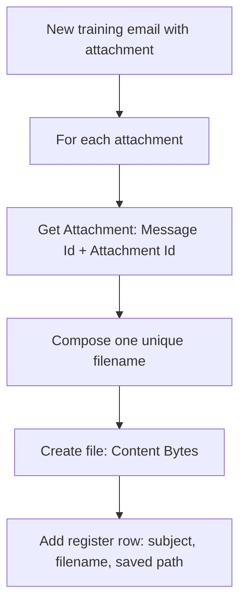

# Optional C: Email-to-Document Register


Saving an attachment is like filing an enclosure and noting its shelf location. Build a flow that saves a fictional training PDF from email to OneDrive, then records the email subject, saved filename and path in Excel.

This is voluntary after-class practice. All setup is included in Practice 1; no other exercise is required.

> **Access:** Use an authorised organisational account with Power Automate cloud flows, an Outlook mailbox, OneDrive for Business and Excel for the web. Office 365 Outlook, OneDrive for Business and Excel Online (Business) are Standard connectors; the organiser must confirm licences, permissions and the agreed environment. No Premium connector, AI action or sharing link is required. Stop at a blocked access step and contact your training contact.



## Practice 1: Prepare your files, folder and register

<PracticeIllustration src="/images/practices/opt-c-p01.webp" alt="A personal folder, document register and two practice files are prepared." />

Prepare your personal destination, blank register and two test PDFs.

1. Open [Power Automate](https://make.powerautomate.com/) with your training account and select the environment agreed with the organiser. Open [Outlook](https://outlook.office.com/mail/) with the same account and identify your own email address.
2. Download [email-document-register.xlsx](/downloads/email-document-register.xlsx), the [reset copy](/downloads/email-document-register-reset.xlsx), [illustrative expected results](/downloads/email-document-register-expected-results.xlsx), [training-document-a.pdf](/downloads/training-document-a.pdf), [training-document-b.pdf](/downloads/training-document-b.pdf) and [sample inputs](/downloads/optional-practice-inputs.txt). Open both PDFs locally to confirm that they contain the fictional training documents.
3. Open [Microsoft 365](https://www.microsoft365.com/) → **Apps → OneDrive**. Create or reuse your own folder:

   ```text
   PowerAutomateOptional
   ```

4. Upload the starter register there. Open it in Excel for the web. Verify worksheet **Register**, Table **DocumentRegisterTable** and three columns **EmailSubject, FileName, SavedPath**. Leave its one blank starter row empty and close the workbook's editing tab.
5. Inside PowerAutomateOptional, create a destination subfolder named:

   ```text
   SavedTrainingDocuments
   ```

   Keep this destination empty for the first test. Use your personal folder, not a shared class folder. You will select it with the flow's folder picker.
6. In Outlook prepare to send new emails to yourself. Remove automatic signatures containing pictures and attach only the supplied PDF for each test. Do not send the test emails yet: save the flow first.

### Quick check

You can access your mailbox, both supplied PDFs, the empty OneDrive destination and your personal three-column register. The expected-results workbook stays separate from the flow.

## Practice 2: Configure the training-email trigger

<PracticeIllustration src="/images/practices/opt-c-p02.webp" alt="A training email is recognised by its trigger." />

Listen for controlled training messages, rather than every email in your mailbox.

1. In Power Automate select **Create → Automated cloud flow**. Name it:

   ```text
   B2-Optional-C-DocumentRegister
   ```

2. Search for this **Office 365 Outlook trigger**, select it and choose **Create**:

   ```text
   When a new email arrives (V3)
   ```

3. Open the trigger. Use an Outlook connection for your training account. To create one, select **+ Add new connection**, supply a connection name, choose **Office 365 (sign in as user)** when an Authentication type field is shown and select **Sign in**. Reuse a valid connection for the same account.
4. Configure these trigger fields. Open **Advanced parameters** to show fields that are hidden:

   | Field | Setting |
   |---|---|
   | Folder | Inbox |
   | Only with Attachments | Yes |
   | Include Attachments | No |
   | Subject Filter | The exact text below |

   ```text
   [TRAINING][DocumentRegister]
   ```

   This is a subject-text filter; a message must contain that text and an attachment. Include Attachments controls the file content, not whether the message has attachment metadata. We retrieve the bytes with Get Attachment in the next practice.

### Quick check

The trigger monitors your Inbox with the training subject filter and attachments required. No test email has been sent yet.

## Practice 3: Retrieve the attachment

<PracticeIllustration src="/images/practices/opt-c-p03.webp" alt="An attachment is retrieved from the matching email." />

Use the message and attachment identifiers to retrieve the actual PDF content.

1. Below the trigger add **Control → Apply to each** and rename it through **… → Rename**:

   ```text
   For_each_attachment
   ```

2. In the loop's array input, insert **Attachments** from **When a new email arrives (V3)**. Leave **Concurrency Control** off.
3. Inside the loop add this **Office 365 Outlook action**:

   ```text
   Get Attachment (V2)
   ```

4. Rename it:

   ```text
   Get_PDF
   ```

5. In **Message Id**, insert **Message Id** from the email trigger. In **Attachment Id**, use **Expression (fx)** to insert this expression without a leading `@`:

   ```text
   items('For_each_attachment')?['id']
   ```

   <div class="subject-reference" role="figure" aria-label="Get Attachment uses the trigger Message Id and the current attachment id expression">
     <span class="subject-reference-label">Message Id</span><div class="subject-reference-field"><span class="subject-reference-token">⚡ Message Id · email trigger</span></div>
     <span class="subject-reference-label">Attachment Id</span><div class="subject-reference-field"><span class="subject-reference-token">fx items('For_each_attachment')?['id']</span></div>
   </div>

   The message ID identifies the envelope; the attachment ID identifies its enclosure. Keep Original Mailbox Address empty because this exercise uses your own mailbox, not a shared mailbox.

### Quick check

Get_PDF is inside For_each_attachment. It uses this message's ID and this iteration's attachment ID; no ID is copied from an earlier email.

## Practice 4: Save the PDF

<PracticeIllustration src="/images/practices/opt-c-p04.webp" alt="A uniquely identified document is saved in a personal folder." />

Create one unique filename and save the retrieved bytes.

1. After Get_PDF, inside the same loop, add **Data Operation → Compose** and rename it:

   ```text
   Saved_File_Name
   ```

2. In **Inputs → Expression (fx)**, paste the following without a leading `@`, then select **Add**:

   ```text
   concat(guid(),'-',body('Get_PDF')?['name'])
   ```

   This adds a unique prefix to the original PDF name. The expression runs once per attachment. Reuse its output; generating another guid in the register would produce a different filename.
3. Add this **OneDrive for Business action** after Compose:

   ```text
   Create file
   ```

4. Create or select a OneDrive for Business connection using the account that owns your destination. Rename the action:

   ```text
   Save_PDF
   ```

5. Configure these fields:

   1. **Folder Path:** use the folder picker to select **PowerAutomateOptional → SavedTrainingDocuments**. Do not paste a sharing URL.
   2. **File Name:** insert **Outputs** from **Saved_File_Name**.
   3. **File Content:** insert **Content Bytes** from **Get_PDF**.

   <div class="subject-reference" role="figure" aria-label="Create file uses the selected destination, Compose filename output and Get_PDF Content Bytes">
     <span class="subject-reference-label">Folder Path · selected folder</span><div class="subject-reference-field">/PowerAutomateOptional/SavedTrainingDocuments</div>
     <span class="subject-reference-label">File Name</span><div class="subject-reference-field"><span class="subject-reference-token">⚡ Outputs · Saved_File_Name</span></div>
     <span class="subject-reference-label">File Content</span><div class="subject-reference-field"><span class="subject-reference-token">⚡ Content Bytes · Get_PDF</span></div>
   </div>

### Quick check

Save_PDF uses one computed filename and actual Content Bytes. File Content does not contain the attachment name, ID or email body. The supplied names retain their .pdf extension.

## Practice 5: Record its saved location

<PracticeIllustration src="/images/practices/opt-c-p05.webp" alt="The saved document location is recorded in a register row." />

Write the register only after the file is saved successfully.

1. After Save_PDF, still inside the loop, add this **Excel Online (Business) action**:

   ```text
   Add a row into a table
   ```

2. Create or select an Excel connection for your account. Select **Location: OneDrive for Business**, your personal **Document Library**, your uploaded **File**, then **Table: DocumentRegisterTable**.
3. Map the three fields using Dynamic content:

   | Column | Inserted value |
   |---|---|
   | EmailSubject | Subject from the email trigger |
   | FileName | Outputs from Saved_File_Name |
   | SavedPath | Path from Save_PDF |

   <div class="subject-reference" role="figure" aria-label="Excel register fields contain the trigger Subject, saved filename output and created file Path">
     <span class="subject-reference-label">EmailSubject</span><div class="subject-reference-field"><span class="subject-reference-token">⚡ Subject · email trigger</span></div>
     <span class="subject-reference-label">FileName</span><div class="subject-reference-field"><span class="subject-reference-token">⚡ Outputs · Saved_File_Name</span></div>
     <span class="subject-reference-label">SavedPath</span><div class="subject-reference-field"><span class="subject-reference-token">⚡ Path · Save_PDF</span></div>
   </div>

4. Leave the default successful-run dependency on Save_PDF. Save the flow and resolve missing fields or connection errors before sending any test email.

### Quick check

The row uses the saved filename output and actual saved Path, not an independently rebuilt filename or a guessed URL. No sharing link is created.

## Practice 6: Verify results and clean up

<PracticeIllustration src="/images/practices/opt-c-p06.webp" alt="Saved files and register rows are verified before cleanup." />

Match two received emails to two saved documents and two register entries.

1. Save the flow, confirm it is turned on, and choose **Test → Manually → Test** to wait for a new message. In Outlook send a new email to your own training address with this Subject and **only training-document-a.pdf** attached. Remove any image signature.

   ```text
   [TRAINING][DocumentRegister] Handover checklist
   ```

2. Open the resulting run from the test panel or **Run history**. Confirm one loop iteration, Get_PDF returning PDF content, Save_PDF succeeding and one successful Excel write. Wait for this run to finish before sending another message.
3. Open the destination in OneDrive. Open the saved PDF and confirm it contains **Training document A - Handover checklist**. Its filename has a unique prefix and still ends with training-document-a.pdf. Check the register row has the same subject, filename and actual Path. Ignore the blank starter row.
4. Send a second new email to yourself with this Subject and **only training-document-b.pdf** attached:

   ```text
   [TRAINING][DocumentRegister] Request summary
   ```

5. Verify the second run, readable document B and its register row. Across the tests expect **two saved PDFs with distinct names and two populated rows**. Compare the pattern with the expected-results workbook; its filenames and paths are clearly fictional examples.
6. In **My flows**, select the practice flow and **Turn off**. Wait for any active run to finish. For a clean retest, upload the reset register as a new personal file and reselect File/Table in the Excel action. Remove only your own test PDFs from the destination when ready for a fresh count. Turn the flow on only for controlled retesting, then off again.

### Quick check

Each register row points to the readable file saved from the corresponding email. The practice flow is off. New copies of the same email can create additional files; unique filenames do not detect duplicate content.

## Troubleshooting

| Symptom | Check |
|---|---|
| No run appears | Save and turn on before sending a new email; check Inbox, exact subject prefix and PDF attachment. The trigger does not process old messages already in Inbox. |
| More than one file appears per email | Inspect attachments and remove image signatures. This controlled exercise uses one PDF per email and does not filter inline images. |
| Get_PDF fails | Check trigger Message Id and the current attachment id expression; both must belong to the same email. |
| PDF is unreadable | File Content must use Content Bytes from Get_PDF. Do not use Name, Id or the email body. |
| Filename differs from register | Reuse Saved_File_Name Outputs; do not call guid separately in the register. |
| File exists but no Excel row | Inspect the Excel connection and Table mapping. Resending creates another file; fix the failure before resetting. |

The controlled tests exclude multiple attachments, file-type rules, folder routing and duplicate detection. A workplace document process also needs agreed permissions, naming and retention rules.

References: [Office 365 Outlook trigger and attachment actions](https://learn.microsoft.com/connectors/office365/), [OneDrive for Business Create file](https://learn.microsoft.com/connectors/onedriveforbusiness/#create-file), [Excel Online (Business)](https://learn.microsoft.com/connectors/excelonlinebusiness/).
